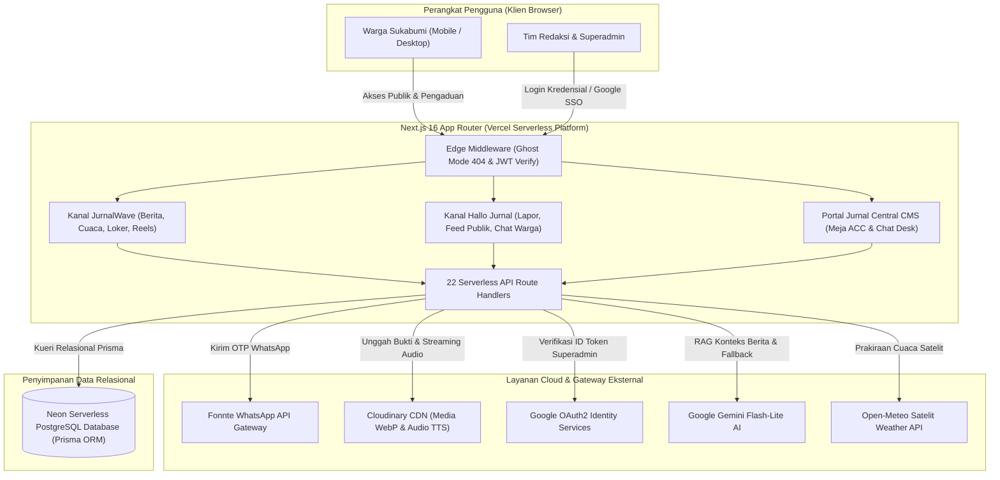
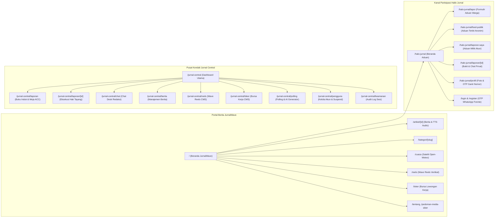
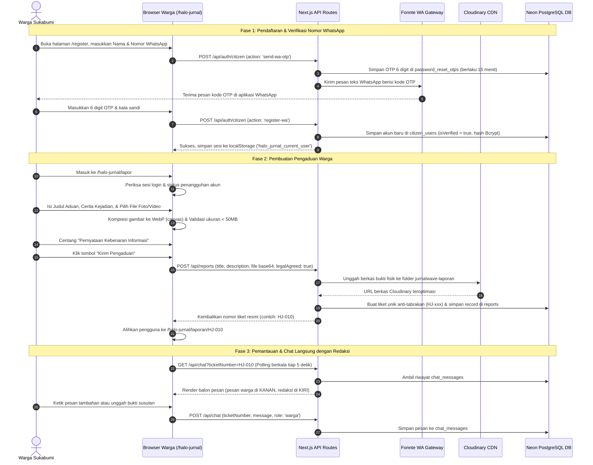
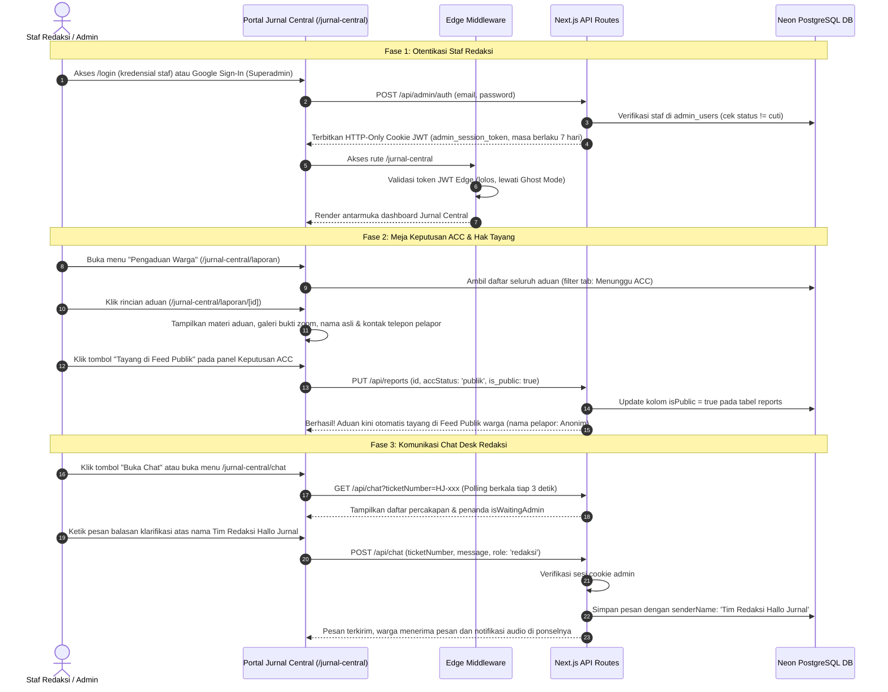

# DOKUMENTASI SISTEM RESMI: JURNALWAVE & HALLO JURNAL (VERSI 7 - KODE MUTAKHIR)

> **Status Dokumen**: Berdasarkan audit kode sumber aktual repositori Git per commit terakhir `1c41f98` (25 November 2026).  
> **Tujuan Dokumen**: Disusun sebagai sumber kebenaran teknis tunggal (*single source of technical truth*) untuk tiga keperluan penulisan:
> 1. **Jurnal Pengabdian kepada Masyarakat (PKM) Penulis A**: Fokus pada implementasi platform aspirasi dan partisipasi warga (*Hallo Jurnal Sisi Warga*).
> 2. **Jurnal Pengabdian kepada Masyarakat (PKM) Penulis B**: Fokus pada arsitektur pusat kendali kurasi redaksi, moderasi, dan pengamanan hak tayang (*Hallo Jurnal Sisi Admin*).
> 3. **Laporan Praktik Kerja Lapangan / Magang**: Dokumentasi komprehensif seluruh sistem (*JurnalWave Portal Berita, Hallo Jurnal, CMS Redaksi, dan Infrastruktur Terpadu*).

---

## CATATAN STATUS INFRASTRUKTUR DAN RENCANA DEPLOYMENT

> [!NOTE]
> **Status Hosting, Domain, dan Server Saat Ini (Fase Uji Coba / Staging)**:  
> Pada tahap pengembangan dan pengujian saat ini, sistem berjalan di atas infrastruktur *cloud serverless* sementara:
> - **Aplikasi & Frontend**: Vercel Serverless Edge Platform (`jurnalwave-website.vercel.app`).
> - **Basis Data**: Neon Serverless PostgreSQL Database (`ep-sweet-dust-...neon.tech`).
> - **Media & Aset CDN**: Cloudinary CDN Cloud Storage (`jurnalwave-articles`, `jurnalwave-laporan`, `jurnalwave-chat`).
> - **Gateway Pesan**: Fonnte WhatsApp API Gateway (layanan berbayar/uji coba perangkat aktif).
> - **Domain Publik**: Menggunakan subdomain Vercel sementara.
>
> **Rencana Migrasi Infrastruktur Mandiri (Dedicated Server & Domain Resmi)**:  
> Untuk operasional komersial dan pelembagaan resmi media:
> - Akan dilakukan penyewaan **Server Mandiri / Cloud VPS Dedicated** (seperti DigitalOcean Droplet, AWS EC2, atau Biznet Gio Cloud) dengan instalasi mandiri container Docker, reverse proxy Nginx, dan database PostgreSQL dedicated untuk menekan latensi dan memegang kedaulatan data penuh.
> - Akan dilakukan pembelian dan pendaftaran **Domain Resmi TLD Berbadan Hukum Pers** (contoh: `.id` atau `.co.id` di bawah naungan PT Media Jurnal Sukabumi).

---

## DAFTAR ISI BERTAUTAN

- [BAB 0 - RINGKASAN `[DIPAKAI OLEH: semua]`](#bab-0---ringkasan-dipakai-oleh-semua)
  - [0.1 Identitas dan Modul Sistem](#01-identitas-dan-modul-sistem)
  - [0.2 Peran dan Hak Akses Pengguna](#02-peran-dan-hak-akses-pengguna)
  - [0.3 Tumpukan Teknologi dan Versi Dependensi](#03-tumpukan-teknologi-dan-versi-dependensi)
  - [0.4 Peta Modul dan Struktur Direktori Proyek](#04-peta-modul-dan-struktur-direktori-proyek)
- [BAB 1 - MATRIKS VERIFIKASI KODE `[DIPAKAI OLEH: semua]`](#bab-1---matriks-verifikasi-kode-dipakai-oleh-semua)
- [BAB 2 - BERSAMA `[DIPAKAI OLEH: semua]`](#bab-2---bersama-dipakai-oleh-semua)
  - [2.1 Skema Basis Data Relasional Prisma](#21-skema-basis-data-relasional-prisma)
  - [2.2 Autentikasi dan Otorisasi Multi-Peran](#22-autentikasi-dan-otorisasi-multi-peran)
  - [2.3 Katalog Lengkap Endpoint API](#23-katalog-lengkap-endpoint-api)
  - [2.4 Status Laporan dan Hak Tayang yang Digunakan Kode](#24-status-laporan-dan-hak-tayang-yang-digunakan-kode)
  - [2.5 Mekanisme Pembuatan Nomor Tiket Anti-Tabrakan](#25-mekanisme-pembuatan-nomor-tiket-anti-tabrakan)
  - [2.6 Mekanisme Ruang Obrolan Terpadu](#26-mekanisme-ruang-obrolan-terpadu)
  - [2.7 Arsitektur Penyimpanan dan Optimasi Berkas](#27-arsitektur-penyimpanan-dan-optimasi-berkas)
  - [2.8 Pola Data: Caching, Mutasi, dan Sinkronisasi State](#28-pola-data-caching-mutasi-dan-sinkronisasi-state)
  - [2.9 Desain Sistem: Warna, Tipografi, dan Breakpoint](#29-desain-sistem-warna-tipografi-dan-breakpoint)
  - [2.10 Variabel Lingkungan, Skrip Operasional, dan Alur Build](#210-variabel-lingkungan-skrip-operasional-dan-alur-build)
  - [2.11 Keamanan, Proteksi Rute, dan Penyamaran Privasi](#211-keamanan-proteksi-rute-dan-penyamaran-privasi)
- [BAB 3 - HALLO JURNAL SISI WARGA `[DIPAKAI OLEH: penulis A dan laporan]`](#bab-3---hallo-jurnal-sisi-warga-dipakai-oleh-penulis-a-dan-laporan)
- [BAB 4 - HALLO JURNAL SISI ADMIN `[DIPAKAI OLEH: penulis B dan laporan]`](#bab-4---hallo-jurnal-sisi-admin-dipakai-oleh-penulis-b-dan-laporan)
- [BAB 5 - JURNAL WAVE SISI PEMBACA `[DIPAKAI OLEH: laporan]`](#bab-5---jurnal-wave-sisi-pembaca-dipakai-oleh-laporan)
- [BAB 6 - JURNAL WAVE CMS `[DIPAKAI OLEH: laporan]`](#bab-6---jurnal-wave-cms-dipakai-oleh-laporan)
- [BAB 7 - RIWAYAT GIT `[DIPAKAI OLEH: laporan; rujukan peran untuk jurnal]`](#bab-7---riwayat-git-dipakai-oleh-laporan-rujukan-peran-untuk-jurnal)
- [BAB 8 - DATA UJI DAN SISA KODE LAMA (LABEL USANG) `[DIPAKAI OLEH: semua]`](#bab-8---data-uji-dan-sisa-kode-lama-label-usang-dipakai-oleh-semua)
- [BAB 9 - DIAGRAM ARSITEKTUR DAN ALUR SISTEM `[DIPAKAI OLEH: semua]`](#bab-9---diagram-arsitektur-dan-alur-sistem-dipakai-oleh-semua)
- [BAB 10 - HAL-HAL YANG TIDAK DITEMUKAN DI KODE `[DIPAKAI OLEH: semua]`](#bab-10---hal-hal-yang-tidak-ditemukan-di-kode-dipakai-oleh-semua)

---

# BAB 0 - RINGKASAN `[DIPAKAI OLEH: semua]`

## 0.1 Identitas dan Modul Sistem
Platform ini beroperasi sebagai media digital terintegrasi yang terdiri dari dua kanal publik utama dan satu portal kendali internal (`app/layout.tsx:14`, `package.json:2`):
1. **JurnalWave**: Portal media berita dan informasi regional Sukabumi Raya yang menyajikan artikel jurnalistik, video *Wave Reels*, bursa lowongan kerja regional (*Loker*), pemantauan cuaca berbasis satelit (*Open-Meteo*), dan asisten percakapan cerdas (*Gemini Flash-Lite AI*).
2. **Hallo Jurnal**: Kanal jurnalisme warga dan pengaduan pelayanan publik Sukabumi yang memfasilitasi pelaporan fasilitas rusak, obrolan dua arah pelapor-redaksi, dukungan suara warga (*upvote*), serta kurasi publikasi terbuka (*Feed Publik*).
3. **Jurnal Central**: Pusat kendali redaksi dan administrasi (*CMS*) berbasis otentikasi ketat untuk moderasi laporan warga, penyuntingan berita, manajemen tim, dan audit keamanan.

## 0.2 Peran dan Hak Akses Pengguna
Berdasarkan implementasi kode (`lib/auth.ts:13-19`, `prisma/schema.prisma:101-127`, `middleware.ts:29-41`):
1. **Publik / Pembaca (Anonim)**: Mengakses seluruh artikel berita, membaca prakiraan cuaca, menonton Wave Reels, melihat lowongan kerja, melihat aduan yang telah disetujui tayang (*Feed Publik*), serta berinteraksi dengan Chatbot AI.
2. **Warga Terdaftar (`CitizenUser`, peran: `'warga'`)**: Warga yang telah mendaftar menggunakan nomor WhatsApp dan memverifikasi kode OTP. Memiliki hak membuat laporan aduan baru (`/halo-jurnal/lapor`), membuka ruang chat privat dengan redaksi untuk tiket miliknya (`/halo-jurnal/laporan/[id]`), melihat riwayat aduan pribadinya (`/halo-jurnal/laporan-saya`), memberikan dukungan suara (1 akun = 1 vote per tiket pada `/api/reports/support`), dan mengedit profil pengguna.
3. **Staf Redaksi (`AdminUser`, peran: `'editor'` / `'staf'`)**: Masuk melalui portal `/jurnal-central` dengan kata sandi terdaftar. Memiliki hak akses terbatas sesuai daftar izin (`permissions`: `'dashboard'`, `'berita'`, `'reels'`, `'loker'`, `'polling'`, `'laporan'`). Dapat membalas obrolan warga atas nama "Tim Redaksi Hallo Jurnal" dan menetapkan hak tayang aduan (`publik` atau `privat`).
4. **Superadmin (`AdminUser`, peran: `'superadmin'`)**: Pemegang kendali penuh yang diautentikasi eksklusif melalui Google OAuth2 ID Token untuk akun resmi `tech.jurnalwave@gmail.com` (`app/api/admin/auth/google/route.ts:54-64`). Memiliki hak mengubah struktur tim redaksi, menangguhkan akun warga, mengelola izin modul, dan mengakses log keamanan.

## 0.3 Tumpukan Teknologi dan Versi Dependensi
Mengacu pada berkas konfigurasi resmi (`package.json:12-42`, `next.config.mjs:1-43`):
- **Kerangka Kerja Inti**: Next.js versi `16.4.6` (App Router Architecture).
- **Runtime & Kompiler UI**: React versi `19.2.8` dan React DOM `19.2.8`.
- **Bahasa Pemrograman**: TypeScript versi `5.0.0+`.
- **Framework Styling**: Tailwind CSS versi `4.0.0+` didukung `@tailwindcss/postcss: ^4`.
- **ORM & Akses Database**: Prisma Client versi `^6.19.3` terhubung ke PostgreSQL.
- **Kriptografi & Sesi**: `jose: ^6.2.13` (JWT standar HS256 untuk Edge Runtime) dan `bcryptjs: ^3.0.3` (hashing sandi warga & staf).
- **Validasi Skema**: Zod versi `^4.6.7`.
- **Ikon Antarmuka**: Lucide React versi `^1.37.0`.
- **Pustaka Pemetaan (Sisa Dependensi)**: `leaflet: ^1.9.4` dan `@types/leaflet: ^1.9.22` (terpasang di `package.json:16, 21`, tetapi komponen peta visual tidak lagi dirender pada formulir lapor aktif).
- **Pengiriman Surat Elektronik**: Nodemailer versi `^10.2.1`.
- **Mesin Suara Text-to-Speech**: `@andresaya/edge-tts: ^1.9.1` (digunakan pada skrip kompilasi berkas audio offline `scripts/generate-audio.mjs`).

## 0.4 Peta Modul dan Struktur Direktori Proyek
```
d:\jurnalwave-website\
├── app\                          # Rute Next.js App Router
│   ├── api\                      # 22 Serverless API Route Handlers
│   │   ├── admin\auth\           # Login kredensial staf & Google Superadmin OAuth2
│   │   ├── admin\citizens\       # Manajemen direktori & penangguhan akun warga
│   │   ├── admin\team\           # Manajemen akun staf redaksi & hak akses
│   │   ├── ai-chat\              # Endpoint Asisten Virtual AI (Gemini Flash-Lite)
│   │   ├── articles\             # CRUD artikel berita & kurasi redaksi
│   │   ├── auth\citizen\         # Registrasi warga, verifikasi OTP WA/Email, Login
│   │   ├── auth\reset-password\  # Reset kata sandi warga via OTP
│   │   ├── categories\           # Manajemen kategori berita resmi
│   │   ├── chat\                 # Pengiriman & pengambilan pesan obrolan dua arah
│   │   ├── jobs\                 # CRUD lowongan kerja regional Sukabumi
│   │   ├── polls\                # Polling interaktif & voting pembaca
│   │   ├── polls\generate-ai\    # Pembuat draf opsi polling otomatis via Gemini
│   │   ├── polls\vote\           # Pencatatan suara pemilih polling
│   │   ├── reels\                # Pengelolaan feed video Wave Reels
│   │   ├── reels\metadata\       # Ekstraksi metadata video pihak ketiga (TikTok/IG)
│   │   ├── reels\[id]\           # Operasi spesifik per reel
│   │   ├── reports\              # CRUD aduan warga, penomoran tiket, update status
│   │   ├── reports\support\      # Dukungan suara warga (upvote 1-akun 1-suara)
│   │   ├── tts\                  # Streaming pemutar suara berita (Cloudinary/Edge-TTS)
│   │   ├── upload\               # Endpoint unggah berkas media (Cloudinary / lokal)
│   │   └── weather\              # Integrasi satelit Open-Meteo per titik koordinat
│   ├── artikel\[id]\             # Halaman baca artikel berita lengkap & player audio
│   ├── cuaca\                    # Halaman prakiraan cuaca satelit 8 hari & grafik 24 jam
│   ├── halo-jurnal\              # Halaman beranda warga Hallo Jurnal
│   │   ├── feed-publik\          # Galeri aduan publik yang telah disetujui redaksi
│   │   ├── lapor\                # Formulir pengaduan warga dengan bukti media
│   │   ├── laporan\[id]\         # Detail aduan, galeri bukti, dan ruang chat privat
│   │   ├── laporan-saya\         # Tab daftar seluruh laporan milik akun warga yang aktif
│   │   └── profil\               # Halaman kelola data diri, ganti nomor HP via OTP, & avatar
│   ├── jurnal-central\           # Pusat kendali redaksi (Admin Dashboard)
│   │   ├── berita\               # Meja editor berita (buat, jadwalkan, headline)
│   │   ├── chat\                 # Chat Desk redaksi (inbox percakapan semua tiket)
│   │   ├── keamanan\             # Panel audit keamanan dan log sesi
│   │   ├── laporan\              # Buku Induk Aduan Warga & Meja Keputusan ACC
│   │   ├── laporan\[id]\         # Rincian aduan meja redaksi & eksekusi hak tayang
│   │   ├── loker\                # Manajemen bursa kerja Sukabumi
│   │   ├── pengguna\             # Tata kelola akun warga & staf redaksi
│   │   ├── polling\              # Manajemen polling interaktif
│   │   └── reels\                # Kurasi klip Wave Reels
│   ├── loker\                    # Halaman publik bursa kerja
│   ├── login\ & register\        # Gerbang masuk dan registrasi akun warga
│   ├── reels\                    # Halaman pemutar video vertikal Wave Reels
│   ├── layout.tsx                # Layout global, header navigasi, audio floating player
│   └── page.tsx                  # Beranda portal berita JurnalWave
├── components\                   # Komponen antarmuka modular
│   ├── admin\                    # AdminSidebar, ConfirmDialog, AdminToast, StatCards
│   ├── halo-jurnal\              # RecentPublicReports, CategoryCards, UserAvatar
│   ├── layout\                   # HeaderNav, BottomNav mobile, FooterNav
│   └── weather\                  # Komponen visual cuaca, grafik hourly, kartu harian
├── context\                      # React Context terpusat (AdminDataContext, AuthContext)
├── data\                         # Data awal fallback & repositori pengetahuan lokal Sukabumi
├── lib\                          # Modul backend singleton (auth, prisma, mail, whatsapp, cloudinary, weather)
├── prisma\schema.prisma          # Skema 14 tabel database relasional PostgreSQL
├── middleware.ts                 # Proteksi Edge rute admin dan pemblokiran jalur lama
└── next.config.mjs               # Konfigurasi Next.js, HTTP security headers, remote patterns
```

---

# BAB 1 - MATRIKS VERIFIKASI KODE `[DIPAKAI OLEH: semua]`

Berikut adalah tabel matriks verifikasi terhadap 15 butir teknis arsitektur yang mencerminkan fakta kode aktual pada repositori berjalan:

| Butir | Parameter Uji | Status Kode | Lokasi File & Baris | Tanggal & Hash Commit Terakhir | Fakta Teknis & Perilaku Nyata di Kode |
| :--- | :--- | :--- | :--- | :--- | :--- |
| **a** | Saluran OTP Pendaftaran & Reset Sandi | **ADA** | `lib/whatsapp.ts:29-84`<br>`lib/mail.ts:15-112`<br>`app/api/auth/citizen/route.ts:121-160`<br>`app/api/auth/reset-password/route.ts:80-95` | `2026-11-25T16:32:17+07:00`<br>`2afaa1a` | **Pendaftaran Warga**: Menggunakan WhatsApp via Fonnte Gateway (`sendWhatsAppOtp`). Kode 6-digit disimpan di database Neon DB (`password_reset_otps`) dengan kunci `wa_${cleanPhone}` dan masa berlaku 15 menit (`Date.now() + 15 * 60 * 1000`). Pesan WhatsApp mencantumkan teks "10 menit". Fallback email menggunakan Nodemailer Gmail SMTP (`sendRegisterOtp`).<br>**Reset Sandi**: Menggunakan email via Nodemailer SMTP (`sendResetPasswordOtp`) dengan masa kedaluwarsa 10 menit (`expiresAtMs = Date.now() + 10 * 60 * 1000`). |
| **b** | Perubahan Status / Tahap Penanganan oleh Admin | **SEBAGIAN** | `app/jurnal-central/laporan/page.tsx:24, 552-573`<br>`app/jurnal-central/laporan/[id]/page.tsx:903-956`<br>`app/api/reports/route.ts:355-417` | `2026-11-25T10:05:07+07:00`<br>`8f976b3` | **Frontend Admin**: Panel "Meja Eksekusi" dengan status tahapan (*diterima, diproses, selesai, ditolak*) **TIDAK LAGI DIRENDER** pada UI. Antarmuka admin hanya menampilkan panel `"Keputusan ACC & Hak Tayang"` dengan opsi `"Tayang di Feed Publik"` (`accStatus = 'publik'`) dan `"Arsip Privat Redaksi"` (`accStatus = 'privat'`).<br>**Backend API**: Endpoint `PUT /api/reports` masih memiliki logika penerimaan parameter `status` dan pencatatan ke `ReportStatusLog`. |
| **c** | Stepper / Penanda Status di Sisi Warga | **TIDAK ADA** | `app/halo-jurnal/laporan/[id]/page.tsx:527-675`<br>`app/halo-jurnal/laporan-saya/page.tsx:351-420` | `2026-11-25T16:44:13+07:00`<br>`16988c0` (merge `1c41f98`) | Fungsi pembantu `getTimelineItems()` masih tertinggal di baris 527-675, tetapi **TIDAK PERNAH DIPANGGIL** di blok return JSX halaman detail. Halaman `/halo-jurnal/laporan-saya` hanya menampilkan kartu berisi nomor tiket, tanggal, judul, deskripsi ringkas, dan thumbnail bukti tanpa badge status penanganan. |
| **d** | Opsi "Laporkan Anonim" & Penyamaran Identitas | **SEBAGIAN** | `app/halo-jurnal/lapor/page.tsx:37, 518-529`<br>`app/halo-jurnal/laporan/[id]/page.tsx:958`<br>`app/halo-jurnal/feed-publik/page.tsx:238` | `2026-11-25T16:44:13+07:00`<br>`16988c0` (merge `1c41f98`) | **Formulir**: Tidak memiliki tombol toggle atau kotak centang pilihan "Laporkan Anonim". Formulir menampilkan banner informasi `"Identitas Terlindungi (Anonim di Publik)"`.<br>**Tampilan Publik**: Identitas pelapor pada halaman detail publik dan feed publik **100% di-hardcode** sebagai teks `"Anonim"` (`<span className="font-semibold text-on-surface">Anonim</span>`). Nama asli hanya tersimpan di database untuk audit redaksi. |
| **e** | Pembatasan Akses Kotak "Chat Langsung" | **ADA** | `app/halo-jurnal/laporan/[id]/page.tsx:709-740, 1046, 1065` | `2026-11-25T16:44:13+07:00`<br>`16988c0` (merge `1c41f98`) | Logika otorisasi memeriksa kesesuaian identitas antara akun aktif (`user.id`, `user.email`, atau normalisasi `user.phone`) dengan data pemilik laporan (`report.userId`, `report.email`, atau `report.telepon`), atau apakah `user.role === 'admin'`. Jika `!canAccessChat`, blok JSX kolom chat di baris 1046 dan 1065 **sama sekali tidak dirender ke DOM**. |
| **f** | Format Nomor Tiket & Mekanisme Server | **ADA** | `app/api/reports/route.ts:223-250` | `2026-11-24T18:12:44+07:00`<br>`e537d11` | Format tiket adalah string `HJ-` diikuti 3 digit angka (contoh: `HJ-010`). Server membaca seluruh tiket terdaftar dari database via Prisma, mem-parsing angka menggunakan regex `/HJ-(\d+)/i`, mencari nilai maksimum (`maxNum`), menambahkan 1 (`nextNum = maxNum + 1`), lalu menjalankan perulangan `while (usedTickets.has(candidate))` untuk memastikan tiket tidak mengalami tabrakan (*collision-free*). |
| **g** | Kolom "Judul Pengaduan" di Formulir | **ADA** | `app/halo-jurnal/lapor/page.tsx:378-390` | `2026-11-25T16:32:17+07:00`<br>`2afaa1a` | Hadir dengan label persis `"Judul Aduan *"` dan placeholder `"Contoh: Lampu PJU padam di Lingkar Selatan / Genangan air di Cisaat"`. Teks dikirim ke backend sebagai atribut `title`. |
| **h** | Kategori / Sub-Kategori di Form, Admin, & API | **SEBAGIAN** | `app/halo-jurnal/lapor/page.tsx:171`<br>`app/jurnal-central/laporan/page.tsx:310`<br>`app/api/reports/route.ts:12-14, 31`<br>`prisma/schema.prisma:44` | `2026-11-25T10:05:07+07:00`<br>`8f976b3` | **Formulir**: Tidak ada dropdown kategori. Kategori di-hardcode ke string `'Pengaduan Warga'`.<br>**Tabel Admin**: Tidak memiliki kolom Kategori (header: Nomor Tiket, Tanggal, Judul Pengaduan, Status ACC, Pelapor, Dukungan).<br>**API & Skema**: Model Prisma masih memiliki field `reportType` (default `'infrastruktur'`) dan API `POST /api/reports` menerima atribut `reportType` atau `category`. |
| **i** | Peta Lokasi, Tombol GPS, & Kolom Domisili | **TIDAK ADA** | `app/halo-jurnal/lapor/page.tsx:191-193`<br>`app/halo-jurnal/profil/page.tsx:36-40`<br>`prisma/schema.prisma:46-47, 120`<br>`app/jurnal-central/laporan/[id]/page.tsx:973-976` | `2026-11-25T10:05:07+07:00`<br>`8f976b3` | **Tampilan UI**: Peta visual (Leaflet) dan tombol GPS tidak dirender. Formulir lapor dan profil warga tidak memiliki input domisili (nilai dikirim `latitude: null`, `longitude: null`, `address: 'Sukabumi'`).<br>**Sisa Kode**: Kolom `latitude`, `longitude`, `address`, dan `domisili` masih ada di skema Prisma, dan admin detail menampilkan string statis `"Lokasi Kejadian"` bernilai `report.lokasi || report.address || 'Sukabumi'`. |
| **j** | Saluran Aspirasi, Informasi, & Inspirasi | **TIDAK ADA** | `app/halo-jurnal/lapor/page.tsx:171, 190`<br>`data/dummyReports.ts:10`<br>`app/halo-jurnal/laporan/[id]/page.tsx:741-746` | `2026-11-25T10:05:07+07:00`<br>`8f976b3` | **Tampilan UI**: Kanal Aspirasi, Informasi, dan Inspirasi tidak lagi memiliki tab atau opsi di formulir warga.<br>**Sisa Kode**: Tipe data `DummyReport` masih memuat union type `'pengaduan' | 'aspirasi' | 'informasi' | 'inspirasi'`, dan detail laporan memuat variabel boolean `isInspirasi`. |
| **k** | Tombol "Hubungi via WhatsApp" & "Buka Chat di Web" di Admin | **SEBAGIAN** | `app/jurnal-central/laporan/[id]/page.tsx:725-737`<br>`app/jurnal-central/loker/page.tsx:217` | `2026-11-25T10:05:07+07:00`<br>`8f976b3` | **Hubungi via WhatsApp**: **TIDAK DITEMUKAN** di halaman detail aduan admin (`app/jurnal-central/laporan/[id]`). Tautan `wa.me` hanya ada di modul Loker.<br>**Buka Chat di Web**: **ADA** dengan label persis `"Buka Chat"` di rincian aduan yang mengarah ke `/jurnal-central/chat?ticket=${report.nomor_tiket}`. |
| **l** | Teks Banner, Tombol Utama, & Tagline Resmi | **ADA** | `app/halo-jurnal/page.tsx:57-63`<br>`components/halo-jurnal/CategoryCards.tsx:17, 25`<br>`app/halo-jurnal/lapor/page.tsx:363, 573` | `2026-11-25T10:05:07+07:00`<br>`8f976b3` | Kutipan Persis:<br>- Hero Landing Warga: `"Suara Anda, Wadah Kami"`, subjudul: `"Sampaikan aduan pelayanan publik Anda secara langsung dan transparan kepada redaksi JurnalWave."`.<br>- Dua Tombol Hero: `"Buat Pengaduan"` dan `"Lihat Daftar Aduan"`.<br>- Header Form Lapor: `"Salurkan Aduan Anda di Hallo Jurnal"`, subjudul: `"Wadah aduan online dan komunikasi warga Sukabumi secara langsung dan transparan."`.<br>- Tombol Submit: `"Kirim Pengaduan"`. |
| **m** | Pernyataan Pertanggungjawaban Hukum (Kotak Centang) | **ADA** | `app/halo-jurnal/lapor/page.tsx:531-548, 564` | `2026-11-25T16:32:17+07:00`<br>`2afaa1a` | Kotak centang hadir dengan label: `"Pernyataan Kebenaran Informasi *"` dan teks pernyataan persis: `"Saya menyatakan bahwa informasi dan bukti yang saya kirimkan adalah benar sesuai kejadian yang saya ketahui. Saya bersedia dihubungi oleh tim redaksi jika diperlukan konfirmasi lebih lanjut."`.<br>**Status Tombol**: Tombol submit dinonaktifkan (`disabled={loading || !file || !legalAgreed}`) jika kotak centang belum dicentang atau berkas bukti kosong. |
| **n** | Jenis, Batas Ukuran Lampiran, & Tempat Simpan | **ADA** | `app/halo-jurnal/lapor/page.tsx:69, 96`<br>`lib/cloudinary.ts:27-56`<br>`app/api/upload/route.ts:56-97`<br>`prisma/schema.prisma:62-72` | `2026-11-24T18:12:44+07:00`<br>`e537d11` | Format didukung: JPG, PNG, WebP, MP4, WebM dengan batas ukuran maksimum 50MB. Gambar dikonversi ke WebP di sisi klien (`convertImageToWebP`). Berkas diunggah ke Cloudinary CDN (folder `'jurnalwave-laporan'` atau `'jurnalwave-chat'`). URL hasil CDN disimpan pada tabel `report_attachments` (`fileUrl String @db.Text`) yang berelasi ke `Report` dengan aturan cascade delete. |
| **o** | Rute Dashboard Admin yang Berlaku & Nama Menu | **ADA** | `middleware.ts:24-41`<br>`components/admin/AdminSidebar.tsx:168-237` | `2026-11-24T18:12:44+07:00`<br>`e537d11` | Rute aktif resmi adalah `/jurnal-central`. Rute lama `/halo-jurnal/admin` dan `/admin` diblokir total oleh Edge Middleware menjadi 404.<br>Nama menu persis pada navigasi sidebar:<br>1. `"Dashboard"` (`/jurnal-central`)<br>2. `"Manajemen Konten"` (`/jurnal-central/berita`)<br>3. `"Wave Reels"` (`/jurnal-central/reels`)<br>4. `"Lowongan Kerja"` (`/jurnal-central/loker`)<br>5. `"Polling Pembaca"` (`/jurnal-central/polling`)<br>6. `"Pengaduan Warga"` (`/jurnal-central/laporan`)<br>7. `"Kelola Pengguna"` (`/jurnal-central/pengguna`)<br>8. `"Keamanan"` (`/jurnal-central/keamanan`). |

---

# BAB 2 - BERSAMA `[DIPAKAI OLEH: semua]`

## 2.1 Skema Basis Data Relasional Prisma
Sistem menggunakan PostgreSQL yang dikelola melalui Prisma ORM (`prisma/schema.prisma:1-231`). Terdiri dari 14 model relasional:

1. **`Article` (`articles`)** (`schema.prisma:12-36`):
   - `id`: `String @id @default(cuid())`
   - `title`: `String @db.VarChar(255)`
   - `slug`: `String @unique @db.VarChar(255)`
   - `excerpt`: `String @db.Text`
   - `content`: `String @db.Text`
   - `category`: `String @default("berita") @db.VarChar(50)`
   - `categoryLabel`: `String? @db.VarChar(50)`
   - `imageUrl`: `String @db.Text`
   - `imageAlt`: `String? @db.VarChar(255)`
   - `author`: `String @default("Tim Redaksi") @db.VarChar(100)`
   - `reporter`: `String? @db.VarChar(100)`
   - `redaktur`: `String? @db.VarChar(100)`
   - `readTime`: `String? @default("5 min read") @db.VarChar(50)`
   - `isHero`: `Boolean @default(false)`
   - `isEditorsPick`: `Boolean @default(false)`
   - `badge`: `String? @db.VarChar(50)`
   - `publishedDate`: `String? @db.VarChar(50)`
   - `status`: `String @default("published") @db.VarChar(50)`
   - `scheduledAt`: `DateTime?`
   - `createdAt`: `DateTime @default(now())`
   - `updatedAt`: `DateTime @updatedAt`

2. **`Report` (`reports`)** (`schema.prisma:39-59`):
   - `id`: `String @id @default(cuid())`
   - `ticketNumber`: `String @unique @db.VarChar(50)`
   - `title`: `String @db.VarChar(255)`
   - `description`: `String @db.Text`
   - `reportType`: `String @default("infrastruktur") @db.VarChar(50)`
   - `address`: `String? @db.Text`
   - `latitude`: `Float?`
   - `longitude`: `Float?`
   - `pelaporName`: `String @default("Warga Sukabumi") @db.VarChar(100)`
   - `pelaporPhone`: `String? @db.VarChar(50)`
   - `pelaporEmail`: `String? @db.VarChar(100)`
   - `status`: `String @default("diterima") @db.VarChar(50)`
   - `isPublic`: `Boolean @default(true)`
   - `createdAt`: `DateTime @default(now())`
   - `updatedAt`: `DateTime @updatedAt`
   - Relasi: `attachments ReportAttachment[]`, `statusLogs ReportStatusLog[]`

3. **`ReportAttachment` (`report_attachments`)** (`schema.prisma:62-72`):
   - `id`: `String @id @default(cuid())`
   - `reportId`: `String` (FK ke `Report.id`, `onDelete: Cascade`)
   - `fileUrl`: `String @db.Text`
   - `fileType`: `String? @db.VarChar(50)`
   - `createdAt`: `DateTime @default(now())`
   - Indeks: `@@index([reportId])`

4. **`ReportStatusLog` (`report_status_logs`)** (`schema.prisma:75-85`):
   - `id`: `String @id @default(cuid())`
   - `reportId`: `String` (FK ke `Report.id`, `onDelete: Cascade`)
   - `status`: `String @db.VarChar(50)`
   - `note`: `String? @db.Text`
   - `createdAt`: `DateTime @default(now())`
   - Indeks: `@@index([reportId])`

5. **`ChatMessage` (`chat_messages`)** (`schema.prisma:88-99`):
   - `id`: `String @id @default(cuid())`
   - `ticketNumber`: `String @db.VarChar(50)`
   - `senderId`: `String @db.VarChar(100)`
   - `senderName`: `String @db.VarChar(100)`
   - `role`: `String @default("warga") @db.VarChar(50)`
   - `message`: `String @db.Text`
   - `createdAt`: `DateTime @default(now())`
   - Indeks: `@@index([ticketNumber])`

6. **`AdminUser` (`admin_users`)** (`schema.prisma:102-112`):
   - `id`: `String @id @default(cuid())`
   - `name`: `String @db.VarChar(100)`
   - `email`: `String @unique @db.VarChar(100)`
   - `role`: `String @default("editor") @db.VarChar(50)`
   - `avatarUrl`: `String? @db.Text` (digunakan juga untuk menyimpan serialisasi JSON kata sandi staf & izin menu)
   - `createdAt`: `DateTime @default(now())`
   - `updatedAt`: `DateTime @updatedAt`

7. **`CitizenUser` (`citizen_users`)** (`schema.prisma:115-127`):
   - `id`: `String @id @default(cuid())`
   - `email`: `String @unique @db.VarChar(100)`
   - `fullName`: `String @db.VarChar(100)`
   - `phone`: `String @db.VarChar(50)`
   - `domisili`: `String? @db.Text`
   - `password`: `String? @db.Text` (hash Bcrypt, nullable jika login via Google)
   - `isVerified`: `Boolean @default(true)`
   - `createdAt`: `DateTime @default(now())`
   - `updatedAt`: `DateTime @updatedAt`

8. **`PasswordResetOtp` (`password_reset_otps`)** (`schema.prisma:130-139`):
   - `id`: `String @id @default(cuid())`
   - `email`: `String @db.VarChar(100)` (juga menyimpan format `wa_${phone}`)
   - `otpCode`: `String @db.VarChar(10)`
   - `expiresAt`: `DateTime`
   - `createdAt`: `DateTime @default(now())`
   - Indeks: `@@index([email])`

9. **`ReportSupport` (`report_supports`)** (`schema.prisma:142-151`):
   - `id`: `String @id @default(cuid())`
   - `ticketNumber`: `String @db.VarChar(50)`
   - `citizenEmail`: `String @db.VarChar(100)`
   - `createdAt`: `DateTime @default(now())`
   - Indeks: `@@unique([ticketNumber, citizenEmail])`, `@@index([ticketNumber])`

10. **`Reel` (`reels`)** (`schema.prisma:154-170`):
    - `id`: `String @id @default(cuid())`
    - `title`: `String @db.VarChar(255)`
    - `category`: `String? @default("Berita") @db.VarChar(50)`
    - `creator`: `String? @default("@jurnalwave") @db.VarChar(100)`
    - `platform`: `String? @default("tiktok") @db.VarChar(50)`
    - `socialUrl`: `String? @db.Text`
    - `videoUrl`: `String? @db.Text`
    - `location`: `String? @default("Sukabumi") @db.VarChar(100)`
    - `thumbnailUrl`: `String @db.Text`
    - `imageAlt`: `String? @db.VarChar(255)`
    - `viewsCount`: `String? @default("0") @db.VarChar(50)`
    - `createdAt`: `DateTime @default(now())`
    - `updatedAt`: `DateTime @updatedAt`

11. **`Poll` (`polls`)** (`schema.prisma:173-183`):
    - `id`: `String @id @default(cuid())`
    - `question`: `String @db.VarChar(500)`
    - `category`: `String? @default("Umum") @db.VarChar(100)`
    - `isActive`: `Boolean @default(true)`
    - `createdAt`: `DateTime @default(now())`
    - `updatedAt`: `DateTime @updatedAt`
    - Relasi: `options PollOption[]`

12. **`PollOption` (`poll_options`)** (`schema.prisma:185-195`):
    - `id`: `String @id @default(cuid())`
    - `pollId`: `String` (FK ke `Poll.id`, `onDelete: Cascade`)
    - `text`: `String @db.VarChar(255)`
    - `votes`: `Int @default(0)`
    - `createdAt`: `DateTime @default(now())`
    - Indeks: `@@index([pollId])`

13. **`Job` (`jobs`)** (`schema.prisma:198-217`):
    - `id`: `String @id @default(cuid())`
    - `title`: `String @db.VarChar(255)`
    - `company`: `String @db.VarChar(255)`
    - `location`: `String @db.VarChar(255)`
    - `region`: `String? @default("Kota Sukabumi") @db.VarChar(100)`
    - `salaryRange`: `String? @db.VarChar(100)`
    - `type`: `String @default("Full-Time") @db.VarChar(50)`
    - `education`: `String? @db.VarChar(100)`
    - `description`: `String @db.Text`
    - `requirements`: `String? @db.Text`
    - `benefits`: `String? @db.Text`
    - `applyEmail`: `String? @db.VarChar(255)`
    - `applyUrl`: `String? @db.Text`
    - `isActive`: `Boolean @default(true)`
    - `createdAt`: `DateTime @default(now())`
    - `updatedAt`: `DateTime @updatedAt`

14. **`Category` (`categories`)** (`schema.prisma:220-229`):
    - `id`: `String @id @default(cuid())`
    - `value`: `String @unique @db.VarChar(100)`
    - `label`: `String @db.VarChar(100)`
    - `order`: `Int @default(0)`
    - `createdAt`: `DateTime @default(now())`
    - `updatedAt`: `DateTime @updatedAt`

## 2.2 Autentikasi dan Otorisasi Multi-Peran
Sistem menerapkan pemisahan arsitektur otentikasi antara warga publik dan staf redaksi:

### A. Otentikasi Sisi Warga (`CitizenUser`)
- **Pendaftaran**: Dilakukan melalui API `POST /api/auth/citizen` (`app/api/auth/citizen/route.ts:100-380`).
  - Alur Standar: Meminta kode OTP WhatsApp (`action = 'send-wa-otp'`). OTP acak 6 digit (`Math.floor(100000 + Math.random() * 900000)`) dikirim via Fonnte Gateway (`sendWhatsAppOtp`).
  - Penyimpanan OTP: Disimpan ganda pada memori in-process `registerOtpStore` dan tabel `password_reset_otps` dengan kunci `wa_${cleanPhone}` berumur 15 menit.
  - Verifikasi: Dilakukan pada `action = 'verify-wa-otp'`, jika valid disimpan status verifikasi sementara `wa_verified_${cleanPhone}` (15 menit).
  - Eksekusi Akun (`action = 'register-wa'`): Kata sandi di-hash menggunakan `bcryptjs` salt 10 rounds (`lib/auth.ts:58-61`). Email otomatis digenerate dengan format `${cleanPhone}@warga.jurnalwave.id` jika warga tidak menginput email pribadi (`route.ts:324`).
- **Penyimpanan Sesi Warga di Browser**: Sesi warga tidak menggunakan JWT cookie, melainkan disimpan pada `localStorage.getItem('halo_jurnal_current_user')` (`lib/auth.ts:73-82`).
- **Reset Kata Sandi Warga**: Menggunakan API `POST /api/auth/reset-password` (`app/api/auth/reset-password/route.ts:80-95`). OTP dikirim ke email terdaftar via Nodemailer Gmail SMTP dan berlaku selama 10 menit.

### B. Otentikasi Sisi Staf & Superadmin (`AdminUser`)
- **Login Staf Redaksi**: Menggunakan form kredensial di `/login` atau modal admin yang memicu API `POST /api/admin/auth` (`app/api/admin/auth/route.ts:49-223`).
  - Proteksi Anti-Brute Force: In-memory rate limiter membatasi 5 kali percobaan gagal per kombinasi IP + Email. Jika gagal 5 kali, form dikunci selama 120 detik (HTTP 429) (`route.ts:18-46`).
  - Sesi Token JWT: Ditandatangani menggunakan pustaka `jose` algoritma HS256 (`lib/auth.ts:24-30`) dengan masa berlaku 7 hari (`setExpirationTime('7d')`).
  - Penyimpanan Cookie: Token disimpan di browser melalui cookie `admin_session_token` dengan konfigurasi `httpOnly: true`, `secure: process.env.NODE_ENV === 'production'`, `sameSite: 'lax'`, `path: '/'`, dan `maxAge: 7 * 24 * 3600` detik (`app/api/admin/auth/route.ts:205-213`).
- **Login Superadmin (Google OAuth2)**:
  - Diproses melalui `POST /api/admin/auth/google` (`app/api/admin/auth/google/route.ts:15-100`).
  - Menerima Google ID Token dari Google Identity Services (GIS).
  - Server memvalidasi token langsung ke Google: `https://oauth2.googleapis.com/tokeninfo?id_token=...` (`route.ts:28-31`).
  - Proteksi Alamat Email: Server memverifikasi kecocokan persis dengan variabel lingkungan `SUPERADMIN_GOOGLE_EMAIL` yang bernilai default `tech.jurnalwave@gmail.com` (`route.ts:7, 55-63`). Akun Google lain akan langsung ditolak dengan status HTTP 403.
- **Middleware Proteksi Edge**:
  - `middleware.ts:29-41` memeriksa setiap permintaan ke rute `/jurnal-central` dan `/jurnal-central/*`.
  - Menggunakan modul ringan `lib/auth.edge.ts:15-23` (`verifyAdminTokenEdge`) yang bebas dependensi modul Node.js native.
  - Jika token tidak valid, middleware melakukan rewrite senyap (*Ghost Mode*) ke `/_not-found` (HTTP 404), sehingga pengunjung liar mengira rute admin tidak pernah ada.

## 2.3 Katalog Lengkap Endpoint API
Seluruh 22 endpoint API Next.js Route Handlers (`app/api`):

| No | Metode | Rute Endpoint | Otorisasi Akses | Validasi Input (Zod / Logika) | Fungsi & Tanggung Jawab Utama | Lokasi File Kode |
| :---: | :---: | :--- | :--- | :--- | :--- | :--- |
| 1 | POST | `/api/admin/auth` | Publik (Staf) | Email valid & password string, in-memory rate limiter 5 percobaan | Otentikasi login staf admin & penerbitan HTTP-Only JWT Cookie 7 hari | `app/api/admin/auth/route.ts:49` |
| 2 | GET | `/api/admin/auth` | Staf (Cookie) | Pembacaan cookie `admin_session_token` via `getAdminSession` | Verifikasi status keaktifan sesi staf admin dari cookie HTTP-Only | `app/api/admin/auth/route.ts:226` |
| 3 | DELETE | `/api/admin/auth` | Staf | - | Logout admin dengan menghapus cookie sesi resmi | `app/api/admin/auth/route.ts:253` |
| 4 | POST | `/api/admin/auth/google` | Publik (Google) | Google ID Token resmi via Google OAuth2 tokeninfo | Verifikasi login Superadmin via Google OAuth (khusus `tech.jurnalwave@gmail.com`) | `app/api/admin/auth/google/route.ts:15` |
| 5 | GET | `/api/admin/citizens` | Admin / Staf | Header token admin | Mengambil daftar seluruh warga terdaftar dari database `CitizenUser` | `app/api/admin/citizens/route.ts:10` |
| 6 | PUT | `/api/admin/citizens` | Admin / Staf | ID/Email warga, status boolean keaktifan akun | Menangguhkan (*suspend*) atau mengaktifkan kembali akun warga | `app/api/admin/citizens/route.ts:45` |
| 7 | GET | `/api/admin/team` | Admin / Staf | Header token admin | Mengambil data seluruh staf redaksi dan rincian izin modul | `app/api/admin/team/route.ts:12` |
| 8 | POST | `/api/admin/team` | Superadmin | Nama, email, role, kata sandi, daftar array permissions | Mendaftarkan akun staf redaksi baru ke database `AdminUser` | `app/api/admin/team/route.ts:50` |
| 9 | POST | `/api/ai-chat` | Publik | Pesan string non-kosong, riwayat chat array | Asisten AI JurnalWave via Google Gemini Flash-Lite dengan Smart Fallback lokal | `app/api/ai-chat/route.ts:72` |
| 10 | GET | `/api/articles` | Publik | Query `category`, `search`, `page`, `limit` | Mengambil daftar artikel berita terbit dengan dukungan caching dan fallback data | `app/api/articles/route.ts:15` |
| 11 | POST | `/api/articles` | Admin / Staf | Skema Zod: judul min 5 kar, konten min 20 kar, slug unik | Membuat draf atau menerbitkan artikel berita baru ke Neon DB | `app/api/articles/route.ts:75` |
| 12 | POST | `/api/auth/citizen` | Publik (Warga) | Multi-action: `send-wa-otp`, `verify-wa-otp`, `register-wa`, `login` | Registrasi, pengiriman OTP WhatsApp, verifikasi, dan login warga | `app/api/auth/citizen/route.ts:80` |
| 13 | POST | `/api/auth/reset-password` | Publik (Warga) | Email warga, kode OTP, kata sandi baru min 6 karakter | Permintaan OTP reset kata sandi warga via email dan pembaharuan hash sandi | `app/api/auth/reset-password/route.ts:15` |
| 14 | GET | `/api/categories` | Publik | - | Mengambil daftar kategori berita resmi JurnalWave | `app/api/categories/route.ts:8` |
| 15 | GET | `/api/chat` | Terbatas | Query `ticketNumber` wajib diisi | Mengambil riwayat pesan obrolan per tiket laporan dari `ChatMessage` | `app/api/chat/route.ts:34` |
| 16 | POST | `/api/chat` | Pelapor / Admin | Zod: ticketNumber, message min 1 kar (maks 50MB string/token) | Mengirim pesan obrolan dua arah warga-redaksi dan mengekstrak berkas Cloudinary | `app/api/chat/route.ts:82` |
| 17 | GET | `/api/jobs` | Publik | Query search, region, type | Mengambil daftar lowongan kerja aktif regional Sukabumi | `app/api/jobs/route.ts:12` |
| 18 | GET | `/api/polls` | Publik | - | Mengambil daftar pertanyaan polling aktif beserta opsi dan jumlah perolehan suara | `app/api/polls/route.ts:8` |
| 19 | POST | `/api/polls/generate-ai` | Admin / Staf | Topik/judul isu regional Sukabumi | Menghasilkan draf pertanyaan & opsi jawaban polling cerdas via Gemini AI | `app/api/polls/generate-ai/route.ts:10` |
| 20 | POST | `/api/polls/vote` | Publik / Warga | `pollId`, `optionId` wajib | Menambahkan 1 suara pada opsi polling tertentu di tabel `PollOption` | `app/api/polls/vote/route.ts:12` |
| 21 | GET | `/api/reels` | Publik | Query limit, category | Mengambil daftar video pendek Wave Reels | `app/api/reels/route.ts:10` |
| 22 | POST | `/api/reels/metadata` | Admin / Staf | URL video TikTok / Instagram | Mengikis (*scraping*) judul dan cover thumbnail video dari URL publik | `app/api/reels/metadata/route.ts:12` |
| 23 | GET | `/api/reels/[id]` | Publik | Parameter ID reel | Mengambil satu video reel spesifik dan menambah counter views | `app/api/reels/[id]/route.ts:10` |
| 24 | GET | `/api/reports` | Publik / Admin | Query `ticketNumber`, `category`, `status` | Mengambil seluruh aduan warga dari Neon DB dengan hitungan dukungan | `app/api/reports/route.ts:80` |
| 25 | POST | `/api/reports` | Warga Login | Zod: title min 3 kar, description, lampiran URL | Membuat laporan aduan baru warga dengan nomor tiket anti-tabrakan `HJ-xxx` | `app/api/reports/route.ts:200` |
| 26 | PUT | `/api/reports` | Admin / Staf | Session token admin, ID laporan, status, is_public | Memperbarui hak tayang (publik/privat) dan status laporan di database | `app/api/reports/route.ts:355` |
| 27 | DELETE | `/api/reports` | Admin / Staf | Session token admin, ID/ticketNumber aduan | Menghapus laporan aduan warga secara permanen berserta seluruh lampiran | `app/api/reports/route.ts:428` |
| 28 | POST | `/api/reports/support` | Warga Login | `ticketNumber` dan `email` akun warga | Memberikan dukungan suara (upvote) atau membatalkannya (1 akun = 1 vote) | `app/api/reports/support/route.ts:5` |
| 29 | GET | `/api/tts` | Publik | Query `id` artikel berita | Menghasilkan streaming audio berita suara ArdiNeural via Cloudinary CDN | `app/api/tts/route.ts:14` |
| 30 | POST | `/api/upload` | Publik / Admin | Multipart form-data atau base64 gambar/video | Mengunggah media fisik ke Cloudinary CDN dengan optimasi format WebP | `app/api/upload/route.ts:8` |
| 31 | GET | `/api/weather` | Publik | Query `loc` (kota, cibadak, palabuhanratu) atau `lat` & `lon` | Mengambil data cuaca satelit presisi Sukabumi dari Open-Meteo API | `app/api/weather/route.ts:4` |

## 2.4 Status Laporan dan Hak Tayang yang Digunakan Kode
Terdapat perbedaan signifikan antara nilai kolom di database dengan apa yang dirender antarmuka pengguna:

1. **Status pada Skema Database (`prisma/schema.prisma:51`)**:
   - Kolom `status` bernilai default `'diterima'`. Nilai yang didukung backend: `'diterima'`, `'diproses'`, `'selesai'`, `'ditolak'`.
2. **Status Hak Tayang Aktual pada Antarmuka Admin (`app/jurnal-central/laporan/page.tsx:24, 554-572` & `app/jurnal-central/laporan/[id]/page.tsx:903-956`)**:
   - Redaksi **hanya menggunakan 3 status kurasi hak tayang**:
     - `'menunggu_acc'`: Laporan baru masuk dari warga, belum disetujui untuk konsumsi publik. Hanya muncul di inbox meja redaksi dan tab laporan pribadi pelapor.
     - `'publik'`: Laporan telah disetujui kurator redaksi, disinkronkan dengan `isPublic = true`, dan otomatis tampil di halaman `/halo-jurnal/feed-publik` dengan identitas pelapor disamarkan menjadi "Anonim".
     - `'privat'`: Laporan diarsipkan secara tertutup oleh redaksi (`isPublic = false`), tidak tampil di Feed Publik, namun ruang obrolan langsung antara pelapor dan redaksi tetap aktif.
3. **Status pada Tampilan Warga**:
   - Warga tidak lagi disajikan stepper tahapan penanganan (*diproses/selesai*). Laporan yang berhak dilihat di feed publik murni ditentukan oleh nilai `isPublic === true`.

## 2.5 Mekanisme Pembuatan Nomor Tiket Anti-Tabrakan
Dihasilkan secara terpusat oleh server di `app/api/reports/route.ts:223-250`:
1. Server mengeksekusi kueri `prisma.report.findMany({ select: { ticketNumber: true } })`.
2. Memasukkan seluruh tiket yang sudah ada ke struktur data `Set` dalam huruf kapital (`usedTickets`).
3. Menjalankan pencarian nilai angka tertinggi menggunakan ekspresi reguler `/HJ-(\d+)/i`. Jika belum ada, baseline `maxNum` dimulai dari 9.
4. Menghitung kandidat tiket berikutnya: `nextNum = maxNum + 1`, menghasilkan string dengan padding nol: `HJ-${String(nextNum).padStart(3, '0')}` (contoh: `HJ-010`).
5. Memvalidasi benturan data: Jika kandidat sudah ada di `usedTickets`, sistem melakukan inkrementasi `nextNum++` dalam loop `while (usedTickets.has(candidate.toUpperCase()))`.
6. Nomor tiket yang dijamin unik dikembalikan ke klien dan dicatat sebagai kunci unik `@unique` pada basis data.

## 2.6 Mekanisme Ruang Obrolan Terpadu
- **Endpoint**: `GET /api/chat?ticketNumber=...` dan `POST /api/chat` (`app/api/chat/route.ts:1-169`).
- **Otorisasi Pengiriman**:
  - Warga hanya dapat mengirim jika identitasnya cocok dengan pemilik tiket (`app/halo-jurnal/laporan/[id]/page.tsx:731-740`).
  - Staf yang mengirim atas nama `role: 'redaksi'` **wajib** memiliki cookie sesi resmi admin (`app/api/chat/route.ts:115-125`). Jika tidak ada sesi admin, server menolak dengan HTTP 401.
- **Transmisi Pesan (Polling Interval)**:
  - Sisi Warga: Polling otomatis berkala setiap **5 detik** (`setInterval(fetchChatMessages, 5000)` di `app/halo-jurnal/laporan/[id]/page.tsx:286-289`) serta mendengarkan event window `storage` dan `focus`.
  - Sisi Admin (Chat Desk): Polling otomatis berkala setiap **3 detik** (`setInterval(..., 3000)` di `app/jurnal-central/chat/page.tsx:226-229`).
- **Penyimpanan Pesan**: Disimpan pada tabel relasional `chat_messages` (`prisma/schema.prisma:88-99`) dan dicadangkan ke `localStorage` browser (`halo_jurnal_chat_${ticket}`) untuk instan render 0ms.
- **Format Lampiran Obrolan**: Lampiran fisik (foto/video) diunggah ke Cloudinary CDN folder `jurnalwave-chat`, lalu disematkan di akhir pesan teks menggunakan token pola:  
  `[ATTACHMENT:<cloudinary_url>|<mime_type>]` (`app/api/chat/route.ts:107`). Fungsi pembantu `parseAttachment()` mengekstrak token ini saat pesan diambil.
- **Notifikasi Audio**: Browser pelapor memutar bunyi denting audio via Web Audio API (`playNotificationChime()`) setiap kali ada pesan baru dari pihak redaksi yang masuk (`app/halo-jurnal/laporan/[id]/page.tsx:257-278`).

## 2.7 Arsitektur Penyimpanan dan Optimasi Berkas
1. **Validasi Ukuran & Format**:
   - Di sisi klien: `app/halo-jurnal/lapor/page.tsx:69, 96` menolak berkas dengan ukuran lebih dari 50MB (`selectedFile.size > 50 * 1024 * 1024`).
   - Format didukung: Berkas gambar (`image/jpeg`, `image/png`, `image/webp`) dan video (`video/mp4`, `video/webm`).
2. **Kompresi Klien**:
   - Gambar yang diunggah warga otomatis dikonversi dan dikompresi ke format WebP di canvas browser (`convertImageToWebP`, dimensi maksimal 1280px, kualitas 85%) sebelum dikirim via HTTP (`lib/imageUtils.ts:1-45`).
3. **Layanan Cloud CDN**:
   - Menggunakan Cloudinary Image & Video Management (`lib/cloudinary.ts:1-56`).
   - Setiap berkas yang disimpan ditransformasikan secara dinamis dengan parameter URL `/upload/f_auto,q_auto/` (`app/api/upload/route.ts:81`), menghasilkan format teringan (AVIF/WebP) sesuai peramban pengguna.
   - Folder penyimpanan: `'jurnalwave-articles'` (berita), `'jurnalwave-laporan'` (bukti aduan warga), `'jurnalwave-chat'` (obrolan), `'jurnalwave-audio'` (MP3 TTS berita).

## 2.8 Pola Data: Caching, Mutasi, dan Sinkronisasi State
- **Server Caching**: Endpoint artikel menggunakan cache in-memory 60 detik (`app/api/articles/route.ts:6`). Mutasi artikel baru langsung menghapus cache (`invalidateArticlesCache()`).
- **Laporan Warga Caching**: Laporan di-cache di memori server dan di-invalidasi seketika saat ada penambahan laporan (`invalidateReportsCache()` di `app/api/reports/route.ts:411, 462`).
- **Client Global State**: Halaman admin menggunakan `AdminDataContext` (`context/AdminDataContext.tsx`) yang membungkus seluruh rute `/jurnal-central`. Data laporan diambil sekali saat layout dibuka, sehingga pergantian menu sidebar berlangsung seketika (0ms) tanpa reload jaringan.

## 2.9 Desain Sistem: Warna, Tipografi, dan Breakpoint
Mengacu pada konfigurasi Tailwind CSS v4 (`app/globals.css`):
- **Palet Warna Resmi**:
  - Warna Utama (Merah JurnalWave): `#c00015` (Primary), `#a00012` (Primary Dark), `#fff1f2` (Primary Tint).
  - Warna Permukaan (Surface Light): `#ffffff`, `#f8fafc` (Surface Low), `#f1f5f9` (Surface High).
  - Warna Mode Gelap (Dark Surface): `#0f172a` (Slate 900), `#1e293b` (Slate 800).
  - Warna Teks: `#0f172a` (On-Surface Primary), `#64748b` (Secondary / Muted).
  - Status Hak Tayang: Publik (`#c00015` / Red-50), Menunggu ACC (`#b45309` / Amber-50), Privat (`#334155` / Slate-100).
- **Tipografi**:
  - Font Heading: Plus Jakarta Sans / Inter dengan class `font-heading font-extrabold`.
  - Font Body: Inter / Sans-Serif sistem dengan class `font-sans`.
- **Breakpoint Responsif**:
  - `sm`: 640px (perangkat ponsel besar / phablet).
  - `md`: 768px (tablet portrait).
  - `lg`: 1024px (laptop / tablet landscape; batas munculnya sidebar admin desktop dan kolom chat ganda).
  - `xl`: 1280px (layar desktop standar).

## 2.10 Variabel Lingkungan, Skrip Operasional, dan Alur Build
### Variabel Lingkungan (Environment Variables)
- `DATABASE_URL`: URL koneksi PostgreSQL pooled Neon DB (mode transaksi serverless).
- `DIRECT_URL`: URL koneksi PostgreSQL langsung untuk eksekusi migrasi Prisma.
- `ADMIN_JWT_SECRET`: Kunci rahasia enkripsi tanda tangan JWT sesi admin.
- `SUPERADMIN_GOOGLE_EMAIL`: Alamat email tunggal pemegang hak Superadmin Google (`tech.jurnalwave@gmail.com`).
- `FONNTE_TOKEN`: Token autentikasi API Gateway WhatsApp Fonnte.
- `SMTP_USER`, `SMTP_PASS`, `SMTP_FROM`: Kredensial akun Gmail SMTP untuk pengiriman surat elektronik OTP.
- `CLOUDINARY_CLOUD_NAME`, `CLOUDINARY_API_KEY`, `CLOUDINARY_API_SECRET`: Kredensial upload CDN Cloudinary.
- `GEMINI_API_KEY`: Kunci akses REST API Google Gemini Generative Language.

### Skrip Operasional (`package.json:5-10`)
- `npm run dev`: Menjalankan server pengembangan lokal dengan Webpack bundler (`next dev --webpack`).
- `npm run build`: Mengompilasi skema Prisma dan membangun bundle produksi (`prisma generate && next build --webpack`).
- `npm run start`: Menjalankan aplikasi hasil kompilasi produksi.
- `npm run lint`: Memeriksa standar kode menggunakan ESLint 9.
- `npm run generate-audio`: Menjalankan generator audio TTS offline ke Cloudinary.

## 2.11 Keamanan, Proteksi Rute, dan Penyamaran Privasi
1. **HTTP Security Headers** (`next.config.mjs:22-32`):
   - `X-Content-Type-Options: nosniff` (mencegah eksploitasi sniffing MIME type).
   - `X-Frame-Options: SAMEORIGIN` (mencegah serangan Clickjacking).
   - `X-XSS-Protection: 1; mode=block` (mengaktifkan filter XSS peramban).
   - `Referrer-Policy: strict-origin-when-cross-origin`.
2. **Proteksi Server-Side Ghost Mode** (`middleware.ts:12-47`):
   - Rute lama `/admin`, `/redaksi`, `/superadmin-auth`, dan `/halo-jurnal/admin` di-rewrite secara diam-diam ke `/_not-found`.
   - Rute `/jurnal-central` hanya dapat diakses jika cookie `admin_session_token` terbukti valid via `verifyAdminTokenEdge`.
3. **Penyamaran Privasi Pelapor Publik**:
   - Di ruang publik (`/halo-jurnal/feed-publik` dan `/halo-jurnal/laporan/[id]`), nama pelapor **selalu ditampilkan sebagai "Anonim"**.
   - Nomor telepon dan alamat email pelapor tidak pernah diekspos ke klien publik dan hanya dapat diakses staf admin yang terotentikasi di meja redaksi (`/jurnal-central/laporan/[id]`).


---

# BAB 3 - HALLO JURNAL SISI WARGA `[DIPAKAI OLEH: penulis A dan laporan]`

Kanal **Hallo Jurnal** dirancang khusus untuk memfasilitasi partisipasi warga Sukabumi dalam menyampaikan aduan fasilitas umum, pelayanan publik, maupun keluhan lingkungan secara langsung, terstruktur, dan transparan.

## 3.1 Rute Halaman Warga
Seluruh rute publik dan partisipasi warga pada kanal Hallo Jurnal meliputi:
- `/halo-jurnal`: Halaman beranda utama kanal Hallo Jurnal dengan banner aksi dan pencarian (`app/halo-jurnal/page.tsx:7`).
- `/halo-jurnal/lapor`: Formulir interaktif pengaduan warga dengan unggah bukti (`app/halo-jurnal/lapor/page.tsx:21`).
- `/halo-jurnal/feed-publik`: Galeri terbuka aduan warga yang telah disetujui kurator redaksi (`app/halo-jurnal/feed-publik/page.tsx:32`).
- `/halo-jurnal/laporan-saya`: Dashboard pribadi pelapor yang memuat seluruh riwayat aduan miliknya (`app/halo-jurnal/laporan-saya/page.tsx:24`).
- `/halo-jurnal/laporan/[id]`: Rincian lengkap aduan publik, galeri bukti, dukungan suara (*upvote*), dan ruang obrolan langsung dua arah dengan redaksi (`app/halo-jurnal/laporan/[id]/page.tsx:106`).
- `/halo-jurnal/profil`: Halaman kelola data diri, ganti nomor WhatsApp dengan verifikasi OTP, dan sesuaikan foto profil (`app/halo-jurnal/profil/page.tsx:28`).
- `/login` & `/register`: Halaman masuk dan registrasi akun warga berbasis verifikasi OTP WhatsApp (`app/login/page.tsx`, `app/register/page.tsx`).

## 3.2 Beranda Hallo Jurnal
Mengacu pada implementasi `app/halo-jurnal/page.tsx:44-120`:
1. **Hero Banner Section**:
   - Judul Utama: `"Suara Anda, Wadah Kami"` (`line 58`).
   - Teks Penjelas: `"Sampaikan aduan pelayanan publik Anda secara langsung dan transparan kepada redaksi JurnalWave."` (`line 62`).
   - Gambar Latar: Aset statis teroptimasi `/hero-banner.webp` dengan lapisan gradasi gelap (`line 49-53`).
2. **Dua Tombol Aksi Utama (`CategoryCards.tsx:13-26`)**:
   - Tombol 1: `"Buat Pengaduan"` (kotak solid putih, mengarah ke `/halo-jurnal/lapor`).
   - Tombol 2: `"Lihat Daftar Aduan"` (kotak transparan kaca *glassmorphism*, mengarah ke `/halo-jurnal/feed-publik`).
3. **Pencarian Terpadu (Search Bar)**:
   - Placeholder: `"Cari aduan publik, jalan rusak, fasilitas..."` (`line 82`).
   - Tombol Form: `"Cari Aduan"` (`line 90`), mengarahkan kueri GET ke `/halo-jurnal/feed-publik?search=...`.
4. **Grid Aduan Publik Terkini**:
   - Judul Bagian: `"Aduan Publik Terkini"` (`line 105`).
   - Deskripsi: `"Pantau perkembangan penanganan pengaduan masyarakat secara terbuka."` (`line 108`).
   - Tautan Lengkap: `"Lihat Semua Aduan"` (`line 116`).
   - Menampilkan maksimal 4 laporan publik terbaru (`line 20`) dengan status `isPublic !== false` yang diambil langsung dari database server via Prisma.

## 3.3 Registrasi Akun Warga
Registrasi akun warga mengutamakan keabsahan nomor kontak WhatsApp untuk mencegah akun anonim palsu dan bot:
1. **Bidang Masukan (Input Fields)**:
   - **Nama Lengkap**: Minimal 2 karakter (`app/api/auth/citizen/route.ts:240`).
   - **Nomor WhatsApp**: Wajib 10 hingga 14 digit angka standar Indonesia (contoh: `081234567890`) (`route.ts:247`).
   - **Kata Sandi**: Minimal 6 karakter (`route.ts:254`).
2. **Alur Verifikasi OTP WhatsApp (`action = 'send-wa-otp'` & `'verify-wa-otp'`)**:
   - Warga menekan tombol minta OTP pada formulir pendaftaran.
   - Server mengecek apakah nomor sudah terdaftar (`route.ts:103-116`). Jika sudah, server menolak dengan pesan: `"Nomor WhatsApp ini sudah terdaftar. Silakan langsung masuk ke akun Anda."` (HTTP 409).
   - Server menghasilkan kode acak 6 digit (`Math.floor(100000 + Math.random() * 900000)`) dan menyimpannya di memori server serta tabel `password_reset_otps` (`email: wa_${cleanPhone}`, masa berlaku 15 menit) (`route.ts:122-139`).
   - Server memanggil Fonnte API Gateway via `sendWhatsAppOtp` (`lib/whatsapp.ts:29-60`) yang mengirimkan pesan teks WhatsApp resmi ke ponsel warga.
   - Warga memasukkan 6 digit kode OTP pada input verifikasi. Jika cocok dan belum kedaluwarsa, server menyimpan status `wa_verified_${cleanPhone}` (15 menit) (`route.ts:204-220`).
3. **Kondisi Akun Setelah Pendaftaran**:
   - Akun langsung aktif dengan `isVerified = true` (`route.ts:337`).
   - Email identitas otomatis dibuat oleh sistem: `${cleanPhone}@warga.jurnalwave.id` (`route.ts:324`) untuk menjamin integritas relasi akun di basis data tanpa memaksa warga memiliki email.
   - Kata sandi dienkripsi permanen menggunakan `bcryptjs` salt 10 rounds (`lib/auth.ts:59`).
   - Data profil disimpan ke peramban warga pada `localStorage` kunci `halo_jurnal_current_user` (`lib/auth.ts:76`).
4. **Arti Badge Verifikasi**:
   - Kolom `isVerified: true` pada tabel `CitizenUser` menunjukkan bahwa nomor WhatsApp telah terbukti aktif dan lolos verifikasi OTP.
   - Jika akun terindikasi melakukan penyalahgunaan atau spam laporan, redaksi dapat melakukan penangguhan (*suspend*) melalui menu Kelola Pengguna, yang mengubah status izin kirim laporan warga.

## 3.4 Login dan Reset Kata Sandi
1. **Opsi Masuk Akun Warga**:
   - **Masuk via WhatsApp & Sandi**: Warga memasukkan nomor WhatsApp atau email beserta kata sandi (`app/api/auth/citizen/route.ts:716-770`). Server memverifikasi hash kata sandi via `comparePassword`.
   - **Masuk Cepat via Google OAuth (`action = 'google-auth'`)**: Warga dapat masuk dengan akun Google (`route.ts:384-429`). Jika email belum terdaftar di `CitizenUser`, akun langsung dibuat otomatis dengan `isVerified = true` dan `password = null`.
2. **Reset Kata Sandi Warga (`/api/auth/reset-password`)**:
   - Warga yang lupa kata sandi dapat meminta kode OTP ke alamat email terdaftar (`action = 'request-otp'`).
   - Server menghasilkan OTP dan mengirimkannya via Nodemailer Gmail SMTP (`sendResetPasswordOtp` di `lib/mail.ts:15-112`).
   - Masa berlaku OTP reset sandi adalah 10 menit (`expiresAtMs = Date.now() + 10 * 60 * 1000`).
   - Setelah kode diverifikasi, warga dapat memasukkan kata sandi baru minimal 6 karakter.

## 3.5 Formulir Pengaduan Warga (`/halo-jurnal/lapor`)
Formulir lapor (`app/halo-jurnal/lapor/page.tsx:358-578`) didesain ringkas, fokus pada fakta lapangan, dan bebas dari selektor yang membingungkan:

1. **Header Formulir**:
   - Judul: `"Salurkan Aduan Anda di Hallo Jurnal"` (`line 363`).
   - Subjudul: `"Wadah aduan online dan komunikasi warga Sukabumi secara langsung dan transparan."` (`line 366`).
2. **Urutan Field Formulir**:
   - **Bidang 1: Judul Aduan (Wajib)**:
     - Label: `"Judul Aduan *"` (`line 378`).
     - Teks Bantuan: `"Tuliskan inti kejadian atau topik yang ingin Anda sampaikan secara singkat."` (`line 380`).
     - Placeholder: `"Contoh: Lampu PJU padam di Lingkar Selatan / Genangan air di Cisaat"` (`line 387`).
     - Validasi: String minimal 3 karakter, maksimal 200 karakter (`app/api/reports/route.ts:10`).
   - **Bidang 2: Isi Cerita & Rincian Kejadian (Wajib)**:
     - Label: `"Isi Cerita & Rincian Kejadian *"` (`line 396`).
     - Teks Bantuan: `"Ceritakan apa yang terjadi, lokasi tepatnya, atau situasi di lapangan secara santai dan jelas."` (`line 399`).
     - Placeholder: `"Ceritakan kejadian yang Anda lihat atau temui, lokasi tepatnya, dan info pendukung lainnya..."` (`line 405`).
     - Komponen: Textarea dengan 5 baris (`rows={5}`).
   - **Bidang 3: Lampiran Bukti Foto/Video (Wajib)**:
     - Label: `"Lampiran Bukti Foto/Video * (Wajib)"` (`line 414`).
     - Area Drag & Drop: `"Klik atau seret file foto/video ke sini"`, `"Format JPG, PNG, MP4, WebM (Maks. 50MB)"` (`line 480-484`).
     - Gambar otomatis dikompresi menjadi WebP via `convertImageToWebP` di canvas browser sebelum diunggah (`line 62-64`).
     - Tampilan Pratinjau: Menampilkan pratinjau foto/video yang dipilih dengan tombol hapus (`line 450-468`).
   - **Bidang 4: Identitas Pelapor Terdaftar (Otomatis)**:
     - Menampilkan nama pelapor terdaftar (`user.fullName`) dan nomor kontak WhatsApp (`user.phone`) yang terkunci sesuai akun login aktif (`line 501-514`).
     - Banner Jaminan Privasi: `"Identitas Terlindungi (Anonim di Publik)"` dengan keterangan `"Data akun dan kontak Anda disimpan secara aman hanya untuk kebutuhan konfirmasi redaksi. Di ruang publik, identitas Anda otomatis dirahasiakan."` (`line 522-527`).
   - **Bidang 5: Kotak Centang Pernyataan Pertanggungjawaban Hukum (Wajib)**:
     - Label: `"Pernyataan Kebenaran Informasi *"` (`line 542`).
     - Teks Pernyataan Persis: `"Saya menyatakan bahwa informasi dan bukti yang saya kirimkan adalah benar sesuai kejadian yang saya ketahui. Saya bersedia dihubungi oleh tim redaksi jika diperlukan konfirmasi lebih lanjut."` (`line 545-546`).
3. **Validasi Klien & Status Tombol Kirim**:
   - Tombol submit: `"Kirim Pengaduan"` (`line 573`).
   - Kondisi Non-Aktif (*Disabled*):  
     `disabled={loading || !file || !legalAgreed}` (`line 564`).  
     Tombol **tidak dapat ditekan** jika bukti berkas belum dipilih atau kotak centang pertanggungjawaban hukum belum dicentang.
   - Pengecekan Penangguhan Akun: Sebelum pengiriman diproses, kode memeriksa apakah ID atau nomor telepon akun warga berstatus ditangguhkan pada `halo_jurnal_citizen_status_overrides` (`line 143-167`). Jika ditangguhkan, sistem membatalkan pengiriman dengan pesan peringatan: `"Mohon maaf, akun Anda sedang ditangguhkan oleh meja redaksi karena pelanggaran ketentuan. Anda tidak dapat mengirimkan laporan."`.

## 3.6 Layar Setelah Pengiriman Laporan
Setelah pengiriman berhasil via API `POST /api/reports`:
1. Server mengembalikan nomor tiket unik anti-tabrakan (contoh: `HJ-010`).
2. Data laporan baru disimpan ke cache browser lokal `halo_jurnal_local_reports` dan disinkronkan ke daftar laporan warga (`app/halo-jurnal/lapor/page.tsx:220-250`).
3. Pengguna langsung dialihkan (*redirect*) ke halaman detail laporan bersangkutan (`/halo-jurnal/laporan/[id]`) untuk dapat langsung meninjau bukti dan memanfaatkan ruang obrolan dengan redaksi.

## 3.7 Halaman "Aduan Saya" (`/halo-jurnal/laporan-saya`)
Halaman ini (`app/halo-jurnal/laporan-saya/page.tsx:24-420`) berfungsi sebagai pusat pemantauan pribadi bagi warga yang telah masuk ke akunnya:
1. **Otorisasi**: Memeriksa sesi akun warga di `localStorage`. Jika belum masuk, menampilkan kartu arahan untuk login.
2. **Daftar Laporan Pribadi**:
   - Memfilter laporan dari database dan local storage yang cocok dengan `user.id`, `user.email`, atau nomor telepon akun aktif (`line 120-160`).
   - Menampilkan kartu laporan dengan urutan kronologis terbaru di paling atas (`orderBy: createdAt desc`).
3. **Struktur Kartu Aduan Warga**:
   - Nomor Tiket: Format `#HJ-xxx` di bagian atas kartu.
   - Tanggal Lapor: Diformat bahasa Indonesia resmi (contoh: `25 Nov 2026`).
   - Judul & Rincian Aduan: Menampilkan judul tebal dan potongan 2 baris deskripsi kejadian.
   - Thumbnail Berkas Bukti: Pratinjau gambar WebP atau ikon video jika terdapat lampiran.
   - Tautan Detail: Menghubungkan kartu langsung ke `/halo-jurnal/laporan/[id]`.
   - **Catatan Status**: Sesuai pembaruan mutakhir, kartu pada halaman ini **tidak menampilkan stepper maupun badge tahapan proses**, memberikan tampilan yang bersih dan berfokus pada konten aduan.

## 3.8 Halaman Rincian Aduan (`/halo-jurnal/laporan/[id]`)
Halaman detail aduan (`app/halo-jurnal/laporan/[id]/page.tsx:106-1273`) menyajikan tampilan komprehensif bagi pembaca umum sekaligus ruang kerja privat bagi pelapor asli:

1. **Struktur Konten Utama (Kolom Kiri)**:
   - **Media Bukti Unggulan (Hero Media)**: Foto resolusi tinggi atau pemutar video HTML5 dengan tombol klik untuk memperbesar foto dalam modal resolusi penuh (`line 880-920`).
   - **Judul & Metadata Laporan**:
     - Menampilkan judul lengkap laporan.
     - Metadata: `"Anonim • Dilaporkan pada [Tanggal] • Lokasi: Sukabumi"` (`line 958`). Identitas pelapor di-hardcode sebagai `"Anonim"` di tampilan publik.
   - **Deskripsi Kejadian**: Paragraf lengkap cerita dan informasi lapangan yang dikirimkan warga.
   - **Dukungan Warga (Upvote)**:
     - Tombol Dukungan: Menampilkan ikon jempol (`ThumbsUp`) dan jumlah dukungan suara warga (`line 1010-1035`).
     - Logika 1 Akun = 1 Suara: Warga wajib login untuk memberi dukungan. Jika sudah pernah mendukung, mengklik kembali tombol akan membatalkan dukungan (*un-vote*) melalui endpoint `POST /api/reports/support`.
   - **Tombol Bagikan (Share)**: Menggunakan Web Share API (`navigator.share`) dengan fallback menyalin tautan laporan ke papan klip (*clipboard*).

2. **Ruang Obrolan Terpadu (Kolom Kanan)**:
   - **Proteksi Akses Obrolan**:
     - Ruang obrolan ini **HANYA MUNCUL** jika pengguna yang sedang membuka halaman adalah pemilik sah laporan tersebut atau staf admin redaksi (`canAccessChat === true` di `line 740, 1065`).
     - Pengunjung umum atau warga lain yang membuka tautan laporan ini **sama sekali tidak dapat melihat panel chat** (elemen chat tidak dirender di DOM).
   - **Pesan Sambutan Otomatis (System Greeting)**:
     - Saat tiket pertama kali dibuka, sistem otomatis memunculkan pesan awal atas nama "Redaksi Hallo Jurnal" (`line 204-214`):  
       `"Halo [Nama Pelapor], terima kasih telah berbagi informasi ini. Ruang obrolan ini dapat Anda gunakan untuk koordinasi langsung atau menambahkan keterangan tambahan jika diperlukan."`.
   - **Tata Letak Balon Percakapan (Chat Bubbles)**:
     - Pesan warga pelapor berada di posisi **KANAN** dengan latar belakang merah khas (`bg-primary text-white`).
     - Pesan balasan staf redaksi berada di posisi **KIRI** dengan latar belakang abu-abu terang (`bg-surface-container-high text-on-surface`) dan avatar resmi Redaksi Hallo Jurnal.
   - **Pengiriman Pesan & Berkas**:
     - Pelapor dapat mengetik teks obrolan dan menyematkan foto/video tambahan langsung di kolom chat.
     - Berkas otomatis diunggah ke Cloudinary dan disematkan ke dalam pesan obrolan.
   - **Pembaruan Data Berkala**: Percakapan di-polling otomatis setiap 5 detik (`setInterval(fetchChatMessages, 5000)` di `line 286`). Bunyi denting notifikasi berbunyi saat pesan redaksi masuk.

3. **Perilaku di Perangkat Mobile**:
   - Pada layar kecil (`< 1024px`), tata letak beralih ke mode panel tunggal.
   - Di bagian bawah detail aduan, terdapat tombol cepat: `"Buka Ruang Chat Redaksi (N)"` (`line 1057`).
   - Menekan tombol ini akan mengalihkan tampilan ke antarmuka obrolan penuh dengan tombol kembali `"Lihat Detail & Riwayat Aduan"` di bagian atasnya (`line 1076`).

## 3.9 Feed Publik (`/halo-jurnal/feed-publik`)
Halaman galeri aduan publik (`app/halo-jurnal/feed-publik/page.tsx:32-350`):
1. **Penyaringan Konten**: Hanya memuat aduan yang telah disetujui kurator redaksi dengan parameter `isPublic === true` (atau status ACC `'publik'`). Laporan berstatus privat atau menunggu ACC tidak akan pernah muncul di halaman ini.
2. **Pencarian & Filter**: Dilengkapi input pencarian teks untuk memfilter laporan berdasarkan kata kunci pada judul atau deskripsi.
3. **Kartu Galeri Publik**:
   - Thumbnail foto bukti terkompresi WebP.
   - Nomor tiket resmi (contoh: `#HJ-010`).
   - Tanggal lapor.
   - Identitas Pelapor: Selalu ditampilkan sebagai `"Anonim"` untuk melindungi privasi warga pelapor dari intimidasi atau potensi sengketa pihak ketiga.
   - Total Dukungan Warga: Menampilkan jumlah suara warga yang mendukung laporan tersebut.

## 3.10 Profil Warga (`/halo-jurnal/profil`)
Halaman profil (`app/halo-jurnal/profil/page.tsx:28-919`) memungkinkan warga mengelola identitas akun mereka:
1. **Nama Lengkap**: Dapat diperbarui secara mandiri oleh warga.
2. **Foto Profil dengan Modal Crop Interaktif**:
   - Warga dapat mengunggah gambar profil baru.
   - Dilengkapi jendela modal pemotongan (*crop modal*) berdiameter aperture 200px (`APERTURE_SIZE = 200`) dengan kontrol geser (*drag & drop*), perbesar/perkecil (*zoom slider*), dan tombol putar ulang (`line 25-60`).
   - Hasil potongan diekspor langsung ke format WebP murni (`canvasToWebP`) berdimensi optimal.
3. **Perubahan Nomor WhatsApp Terikat**:
   - Mengubah nomor kontak WhatsApp tidak dapat dilakukan sembarangan.
   - Warga wajib memasukkan nomor baru, menekan tombol kirim kode OTP, dan memverifikasi kode 6 digit yang dikirimkan ke nomor WhatsApp baru tersebut via Fonnte Gateway sebelum nomor resmi diperbarui di basis data.

---

# BAB 4 - HALLO JURNAL SISI ADMIN `[DIPAKAI OLEH: penulis B dan laporan]`

Portal administrasi **Jurnal Central** (`/jurnal-central`) adalah pusat komando meja redaksi untuk memoderasi aduan warga, memvalidasi bukti di lapangan, berkomunikasi langsung via chat desk, menetapkan hak tayang publikasi, dan mengelola keamanan sistem.

## 4.1 Rute Halaman Admin dan Nama Menu Persis
Seluruh antarmuka admin diatur dalam struktur tata letak terpadu di bawah rute `/jurnal-central` (`components/admin/AdminSidebar.tsx:168-237`):

1. **Menu Utama**:
   - `"Dashboard"`: `/jurnal-central` (Ringkasan statistik metrik editorial dan layanan warga).
2. **Menu Redaksi Media**:
   - `"Manajemen Konten"`: `/jurnal-central/berita` (Pusat redaksi artikel berita, draf, jadwal terbit, dan Headline).
   - `"Wave Reels"`: `/jurnal-central/reels` (Kurasi video pendek vertikal dan scraping metadata sosial).
   - `"Lowongan Kerja"`: `/jurnal-central/loker` (Manajemen bursa kerja regional Sukabumi).
   - `"Polling Pembaca"`: `/jurnal-central/polling` (Manajemen jajak pendapat dan generator opsi AI).
3. **Menu Layanan Warga**:
   - `"Pengaduan Warga"`: `/jurnal-central/laporan` (Buku Induk Aduan Warga dan Meja Keputusan ACC).
4. **Menu Sistem**:
   - `"Kelola Pengguna"`: `/jurnal-central/pengguna` (Tata kelola direktori akun warga dan akun staf redaksi).
   - `"Keamanan"`: `/jurnal-central/keamanan` (Pusat audit log keamanan dan pemantauan sesi login).
5. **Halaman Pendukung Terhubung**:
   - Ruang Chat Terpusat: `/jurnal-central/chat` (diakses via tombol chat di tabel laporan dan rincian aduan).
   - Meja ACC & Detail Aduan: `/jurnal-central/laporan/[id]` (diakses via klik baris atau ikon rincian aduan).

## 4.2 Login Admin dan Tingkatan Hak Akses Peran
1. **Otentikasi Staf Redaksi (Kredensial Email & Kata Sandi)**:
   - Staf redaksi masuk melalui endpoint `POST /api/admin/auth` (`app/api/admin/auth/route.ts:49-223`).
   - Dilindungi proteksi anti-brute force: Maksimal 5 kali kegagalan, setelah itu akun dikunci sementara selama 120 detik.
   - Kata sandi diverifikasi langsung ke tabel `admin_users` Neon DB. Jika status staf bernilai `'cuti'`, akses otomatis ditolak dengan pesan: `"Akun Anda sedang dinonaktifkan (status cuti). Silakan hubungi Superadmin."` (`route.ts:106-114`).
   - Sesi diterbitkan dalam bentuk HTTP-Only Cookie JWT berdurasi 7 hari (`admin_session_token`).
2. **Otentikasi Superadmin (Eksklusif Google OAuth2 ID Token)**:
   - Superadmin tidak dapat login menggunakan formulir staf biasa (`route.ts:79-87`).
   - Superadmin wajib mengotentikasi melalui Google Identity Services pada endpoint `POST /api/admin/auth/google` (`app/api/admin/auth/google/route.ts:15-100`).
   - Server memvalidasi keaslian token langsung ke server Google OAuth2 dan memastikan alamat email **persis cocok dengan `tech.jurnalwave@gmail.com`**.
3. **Matriks Hak Akses Modul (`HREF_TO_PERMISSION` di `AdminSidebar.tsx:239-248`)**:
   - Superadmin (`role: 'superadmin'`): Memiliki akses mutlak ke seluruh 8 modul sistem.
   - Editor / Staf Redaksi (`role: 'editor'` / `'staf'`): Hak akses dibatasi secara granular berdasarkan array `permissions` yang diberikan Superadmin:
     - `'dashboard'`: Mengakses `/jurnal-central`.
     - `'berita'`: Mengakses `/jurnal-central/berita`.
     - `'reels'`: Mengakses `/jurnal-central/reels`.
     - `'loker'`: Mengakses `/jurnal-central/loker`.
     - `'polling'`: Mengakses `/jurnal-central/polling`.
     - `'laporan'`: Mengakses `/jurnal-central/laporan`, `/jurnal-central/laporan/[id]`, dan `/jurnal-central/chat`.
     - `'pengguna'`: Mengakses `/jurnal-central/pengguna` dan `/jurnal-central/keamanan`.

## 4.3 Dashboard Admin (`/jurnal-central`)
Halaman ringkasan eksekutif redaksi (`app/jurnal-central/page.tsx:1-250`):
- Menyajikan kartu statistik operasional real-time yang bersumber dari `AdminDataContext`:
  - Total Seluruh Aduan Masuk.
  - Jumlah Aduan Menunggu ACC (indikator beban kerja moderasi redaksi).
  - Jumlah Aduan yang Telah Terbit Publik.
  - Jumlah Percakapan Warga Aktif.
  - Total Artikel Berita Terbit.
- Menampilkan grafik tren publikasi berita dan tabel ringkasan 5 aduan warga paling mutakhir yang membutuhkan tinjauan.

## 4.4 Buku Induk Aduan Warga (`/jurnal-central/laporan`)
Merupakan meja kerja utama kurator aduan warga (`app/jurnal-central/laporan/page.tsx:1-625`):

1. **Header & Aksi Ekspor**:
   - Judul Halaman: `"Pengaduan Warga"` (`line 341`).
   - Keterangan: `"Pusat moderasi, peninjauan (ACC), dan penetapan hak tayang aduan warga Sukabumi."` (`line 344`).
   - Tombol Ekspor CSV: `"Ekspor CSV"` (`line 355`).
     - Menghasilkan berkas dengan nama pola: `aduan-halo-jurnal-YYYY-MM-DD.csv` (`line 328`).
     - Kolom Berkas CSV: `['Nomor Tiket', 'Tanggal', 'Judul Pengaduan', 'Status ACC / Hak Tayang', 'Pelapor', 'Dukungan']` (`line 310`).
2. **Filter Tab Status ACC Terpadu**:
   - Tab 1: `"Semua"` (menampilkan seluruh laporan terdaftar).
   - Tab 2: `"Menunggu ACC"` (laporan baru warga yang butuh diverifikasi).
   - Tab 3: `"Tayang Publik"` (laporan yang disetujui tampil di Feed Publik).
   - Tab 4: `"Privat"` (laporan yang diarsipkan tertutup oleh redaksi).
3. **Pencarian & Paginasi Data**:
   - Kotak pencarian menyaring laporan secara instan berdasarkan nomor tiket, judul, isi cerita, nama pelapor asli, maupun nomor kontak pelapor.
   - Paginasi data berukuran 10 baris per halaman (`PAGE_SIZE = 10`).
4. **Struktur Kolom Tabel Buku Induk (`headers` di `line 310, 520-615`)**:
   - **Kolom 1: Nomor Tiket & Waktu**: Menampilkan format `#HJ-xxx`, tanggal lengkap, dan waktu lapor.
   - **Kolom 2: Judul & Rincian Pengaduan**: Menampilkan judul aduan tebal dan 1 baris cuplikan isi deskripsi kejadian.
   - **Kolom 3: Status ACC / Hak Tayang**: Berupa elemen pemilih `<select>` interaktif (`line 554-572`) yang memungkinkan staf mengubah hak tayang seketika antara:
     - `menunggu_acc` (label: "Menunggu ACC", opsi nonaktif jika sudah dipilih).
     - `publik` (label: "Tayang Publik", badge warna merah muda / `#c00015`).
     - `privat` (label: "Privat", badge abu-abu slate).
   - **Kolom 4: Pelapor**: Menampilkan nama asli pelapor dan nomor telepon kontak yang tersimpan di sistem (hanya terlihat oleh staf admin).
   - **Kolom 5: Dukungan**: Menampilkan total suara upvote warga dengan ikon jempol.
   - **Kolom 6: Aksi Cepat**:
     - Ikon Pesan (`MessageSquare`): Buka ruang chat dengan pelapor (`/jurnal-central/chat?ticket=...`).
     - Ikon Tautan Eksternal (`ExternalLink`): Buka detail lengkap aduan dan meja ACC (`/jurnal-central/laporan/[id]`).
     - Ikon Tong Sampah (`Trash2`): Hapus aduan secara permanen dari sistem dengan dialog konfirmasi keamanan (`useConfirm`).

## 4.5 Halaman Rincian Aduan & Meja ACC (`/jurnal-central/laporan/[id]`)
Halaman kerja kurator untuk menganalisis kebenaran materi laporan (`app/jurnal-central/laporan/[id]/page.tsx:1-1034`):

1. **Kolom Kiri (7 Kolom Grid Desktop) - Materi Laporan**:
   - **Judul Laporan**: Ditampilkan dalam tipografi tebal (`font-heading font-extrabold text-xl`).
   - **Isi Laporan Warga**: Paragraf penuh uraian kejadian yang disampaikan warga.
   - **Galeri Foto/Video Bukti Lapangan**:
     - Menampilkan seluruh berkas fisik yang diunggah warga.
     - Mengklik gambar akan membuka modal pratinjau resolusi tinggi dengan tombol tutup khusus yang ramah layar sentuh (`line 996-1025`).
   - **Kotak Identitas & Kontak Pelapor (`line 700-750`)**:
     - Menampilkan nama pelapor asli (`pelaporNama`).
     - Menampilkan nomor telepon kontak asli pelapor (`rawPhone`).
     - Tombol `"Buka Chat"` (`line 731`): Mengarahkan staf langsung ke ruang obrolan tiket ini di `/jurnal-central/chat?ticket=...` dengan penanda jumlah pesan aktif.
     - Tombol Tindakan Penangguhan: Staf dapat menangguhkan akun pelapor jika ditemukan indikasi laporan palsu atau fitnah.

2. **Kolom Kanan (5 Kolom Grid Desktop) - Panel Keputusan ACC & Hak Tayang**:
   - Header Panel: `"Keputusan ACC & Hak Tayang"` (`line 904`).
   - Badge Status Saat Ini: Menampilkan indikator pill (`Tayang Publik`, `Menunggu ACC`, atau `Privat`).
   - **Dua Tombol Eksekusi Hak Tayang (`line 926-956`)**:
     - Tombol 1: `"Tayang di Feed Publik"` (menetapkan `accStatus = 'publik'`, menyinkronkan `isPublic = true`, dan memperbarui status di database).
     - Tombol 2: `"Arsip Privat Redaksi"` (menetapkan `accStatus = 'privat'`, menyinkronkan `isPublic = false`).
   - **Ringkasan Metadata Aduan (`line 958-978`)**:
     - Nomor Tiket: `#HJ-xxx`.
     - Tanggal Lapor: Diformat bahasa Indonesia resmi.
     - Dukungan Warga: Menampilkan jumlah suara warga (`N suara`).
     - Lokasi Kejadian: Menampilkan teks lokasi (`report.lokasi || report.address || 'Sukabumi'`).
   - **Tombol Hapus Permanen (`line 981-990`)**:
     - Label Persis: `"Hapus Aduan Ini Secara Permanen"`.
     - Menghapus record laporan, seluruh lampiran di Cloudinary, dan riwayat status dari database via `DELETE /api/reports?id=...`.

## 4.6 Chat Warga di Admin (Chat Desk) (`/jurnal-central/chat`)
Merupakan ruang komunikasi langsung antara tim redaksi dan warga pelapor (`app/jurnal-central/chat/page.tsx:1-723`):

1. **Tata Letak Split-Pane (Dua Kolom)**:
   - **Kolom Kiri (Inbox Percakapan / Daftar Tiket)**:
     - Memuat seluruh tiket aduan warga yang tersimpan di sistem.
     - Input pencarian untuk mencari percakapan berdasarkan nama warga atau nomor tiket.
     - Filter status obrolan: `Semua`, `Belum Dibalas`, dan `Sudah Direspon`.
     - Badge Pesan Belum Dibaca: Menampilkan angka pesan warga yang belum dibuka staf redaksi.
     - Penanda Status `isWaitingAdmin`: Tiket diberi penanda prioritas jika pesan terakhir dikirimkan oleh warga pelapor dan belum mendapat respons dari staf.
   - **Kolom Kanan (Ruang Percakapan Aktif)**:
     - Header Chat: Menampilkan nomor tiket aktif, nama pelapor, judul aduan, dan tautan langsung untuk membuka halaman rincian aduan.
     - Thread Pesan: Menampilkan seluruh riwayat percakapan. Balon pesan warga berada di sebelah **KIRI**, sedangkan balon pesan balasan redaksi berada di sebelah **KANAN** dengan identitas resmi: `"Tim Redaksi Hallo Jurnal"`.
     - Tampilan Lampiran: Jika warga mengirimkan foto atau video bukti tambahan di obrolan, berkas langsung dirender di dalam bubble dengan kemampuan klik untuk memperbesar foto.
2. **Mekanisme Pengiriman Balasan Redaksi**:
   - Staf mengetik balasan di input chat bawah dan menekan tombol kirim (`line 246-270`).
   - Pesan dikirimkan ke `POST /api/chat` dengan payload `role: 'redaksi'`.
   - Server memverifikasi keabsahan cookie sesi admin (`app/api/chat/route.ts:115`). Jika valid, pesan disimpan dengan atribut `senderName: 'Tim Redaksi Hallo Jurnal'` dan `role: 'redaksi'`.
3. **Sinkronisasi & Polling Interval**:
   - Chat Desk memindai percakapan secara otomatis setiap **3 detik** (`setInterval(..., 3000)` di `app/jurnal-central/chat/page.tsx:226-229`).
   - Mendengarkan event jendela `storage` dan `focus`, sehingga jika ada pesan baru yang masuk di tab lain, daftar chat langsung diperbarui seketika tanpa perlu memuat ulang halaman.

## 4.7 Tata Kelola Pengguna (`/jurnal-central/pengguna`)
Pusat kontrol identitas warga dan staf redaksi (`app/jurnal-central/pengguna/page.tsx`):
1. **Tab Warga Terdaftar**:
   - Menampilkan seluruh data akun warga dari tabel `CitizenUser`: Nama lengkap, nomor WhatsApp, email identitas, tanggal registrasi, dan status keaktifan.
   - Aksi Penangguhan Akun (*Suspend*): Staf Superadmin dapat menonaktifkan akun warga yang terbukti melanggar hukum. Warga yang ditangguhkan tidak dapat lagi mengirimkan laporan baru di formulir `/halo-jurnal/lapor`.
2. **Tab Staf Redaksi & Manajemen Tim**:
   - Menampilkan seluruh akun staf redaksi dari tabel `AdminUser`.
   - Menambah Anggota Staf Baru: Memasukkan nama, email, peran (*editor/staf*), kata sandi akun, dan memilih daftar izin modul (`permissions`).
   - Mengubah Status Kerja: Superadmin dapat mengubah status staf menjadi `'aktif'` atau `'cuti'`. Staf berstatus cuti akan otomatis diblokir saat mencoba login ke sistem.


---

# BAB 5 - JURNAL WAVE SISI PEMBACA `[DIPAKAI OLEH: laporan]`

Kanal **JurnalWave** (`app/page.tsx`, `components/layout/HeaderNav.tsx`) beroperasi sebagai media massa siber profesional yang menyajikan berita, liputan mendalam, informasi cuaca satelit, bursa lowongan kerja, video pendek kreatif, dan asisten kecerdasan buatan bagi masyarakat Sukabumi Raya.

## 5.1 Rute Portal Berita
Seluruh rute publik portal media JurnalWave meliputi:
- `/`: Halaman beranda utama portal JurnalWave (`app/page.tsx:1`).
- `/artikel/[id]`: Halaman baca artikel berita lengkap terintegrasi pemutar audio TTS (`app/artikel/[id]/page.tsx:1`).
- `/kategori/[slug]`: Halaman arsip berita berdasarkan kategori spesifik (contoh: Berita, Lifestyle, Wisata, Kuliner, dll).
- `/cuaca`: Layanan prakiraan cuaca satelit real-time wilayah Sukabumi (`app/cuaca/page.tsx:1`).
- `/reels`: Kanal hiburan video vertikal pendek Wave Reels Sukabumi (`app/reels/page.tsx:1`).
- `/loker`: Direktori bursa lowongan kerja regional Sukabumi (`app/loker/page.tsx:1`).
- `/bookmark`: Halaman daftar artikel berita yang disimpan oleh pembaca secara lokal.
- `/indeks`: Halaman indeks berita berdasarkan tanggal terbit kronologis.
- `/tentang`: Halaman profil redaksi, struktur organisasi, visi, misi, dan tagline resmi media.
- `/pedoman-media-siber`, `/kebijakan-privasi`, `/syarat-ketentuan`: Halaman kepatuhan hukum dan regulasi Dewan Pers.

## 5.2 Beranda Portal Berita (`/`)
Mengacu pada arsitektur `app/page.tsx`:
1. **Hero Carousel Berita Utama**:
   - Menampilkan artikel berita unggulan bertanda `isHero: true` yang dikurasi oleh Dewan Redaksi.
   - Dilengkapi navigasi slide otomatis dan manual dengan indikator titik posisi.
2. **Editor's Pick (Pilihan Redaksi)**:
   - Menampilkan artikel berkualitas tinggi yang ditandai `isEditorsPick: true`.
3. **Widget Cuaca Ringkas Sukabumi**:
   - Menampilkan kondisi suhu, kelembaban, dan ikon cuaca terkini untuk Kota dan Kabupaten Sukabumi yang disinkronkan dari Open-Meteo.
4. **Feed Berita Berdasarkan Kategori**:
   - Mengelompokkan berita ke dalam kanal tematik: Berita Daerah, Politik & Hukum, Ekonomi & Bisnis, Budaya & Wisata, serta Gaya Hidup (*Lifestyle*).
5. **Klip Populer Wave Reels**:
   - Cuplikan video pendek vertikal 9:16 terbaru yang dapat langsung diputar pembaca.
6. **Bursa Kerja Sukabumi Terkini**:
   - Kartu lowongan kerja terbaru di Sukabumi dengan rentang gaji dan jenis pekerjaan.
7. **Polling Interaktif Pembaca**:
   - Kotak jajak pendapat isu hangat Sukabumi yang memungkinkan pembaca langsung memilih opsi dan melihat persentase suara.

## 5.3 Detail Artikel Berita & Pemutar Audio TTS (`/artikel/[id]`)
Halaman baca berita (`app/artikel/[id]/page.tsx:1-450`) dilengkapi teknologi pendukung kenyamanan membaca:

1. **Struktur Konten Jurnalistik**:
   - Judul Berita: Ditampilkan dalam font heading tebal dengan kontras tinggi.
   - Atribusi Jurnalistik Resmi:
     - Kategori Berita.
     - Nama Reporter Lapangan (`reporter`) dan Redaktur Pemeriksa (`redaktur`).
     - Tanggal & Waktu Publikasi Resmi.
     - Estimasi Waktu Baca (`readTime`, contoh: `"3 min read"`).
   - Gambar Sampul Utama (Hero Image): Ditransformasi dinamis dari Cloudinary CDN (`f_auto,q_auto`) dengan teks keterangan gambar (*caption / alt*).
   - Isi Lengkap Berita: Paragraf jurnalistik terstruktur yang mendukung format kutipan (*blockquote*) dan penekanan teks.

2. **Pemutar Audio Berita TTS (Audio Player)**:
   - Terintegrasi dengan endpoint `GET /api/tts?id=[id]` (`app/api/tts/route.ts:14-53`).
   - Sumber Suara: Menggunakan profil suara presenter pria Indonesia alami Microsoft Azure Neural TTS: **`id-ID-ArdiNeural`**.
   - Arsitektur Distribusi Cloud: Berkas audio berformat MP3 disimpan secara permanen di Cloudinary CDN folder `jurnalwave-audio/${id}.mp3`.
   - Streaming Tanpa Beban Kuota Server: Endpoint `/api/tts` memeriksa ketersediaan berkas di Cloudinary CDN; jika tersedia, server langsung melakukan pengalihan HTTP 307 (*Temporary Redirect*) ke URL Cloudinary, sehingga streaming audio ditangani oleh CDN global berlatensi 0ms tanpa membebani bandwidth server Vercel.
   - Floating Audio Player Bar: Pemutar audio dapat diminimalkan menjadi bilah mengambang di bagian bawah layar saat pembaca menggulir halaman, dilengkapi kontrol Putar/Jeda (*Play/Pause*), penggeser durasi waktu (*scrubber*), dan indikator kecepatan putar.

3. **Fitur Pendukung Pembaca**:
   - **Simpan Berita (Bookmark)**: Disimpan pada `localStorage` peramban pembaca, dapat diakses kembali di halaman `/bookmark`.
   - **Bagikan Berita**: Integrasi tombol bagikan ke WhatsApp, Facebook, X (Twitter), dan penyalinan tautan langsung.
   - **Berita Terkait**: Menampilkan 3 hingga 4 artikel berita lain dalam kategori yang sama.

## 5.4 Layanan Cuaca Satelit Sukabumi (`/cuaca`)
Halaman pemantauan cuaca mutakhir Sukabumi (`app/cuaca/page.tsx:1-350` & `lib/weather.ts:1-312`):
1. **Sumber Data Tanpa API Key**:
   - Mengintegrasikan data meteorologi satelit dari Open-Meteo API yang diperbarui berkala tanpa biaya lisensi.
2. **Titik Koordinat Presisi Wilayah Sukabumi (`lib/weather.ts:53-110`)**:
   - Kota Sukabumi: Lintang -6.9277, Bujur 106.9299.
   - Kabupaten Sukabumi: Lintang -6.9875, Bujur 106.5414.
   - Kecamatan Cibadak: Lintang -6.8928, Bujur 106.7828.
   - Kecamatan Cisaat: Lintang -6.9150, Bujur 106.8920.
   - Kawasan Wisata Selabintana: Lintang -6.8830, Bujur 106.9450.
   - Palabuhanratu (Pesisir Selatan): Lintang -6.9875, Bujur 106.5414.
   - Kawasan Cikole: Lintang -6.9180, Bujur 106.9320.
   - Jalan Goalpara: Lintang -6.8970, Bujur 106.9650.
3. **Fitur Analisis Cuaca**:
   - Kondisi Cuaca Terkini: Suhu udara (°C), suhu yang dirasakan (*apparent temperature*), kelembaban relatif (%), kecepatan angin (km/jam), persentase presipitasi hujan, dan Indeks Kualitas Udara (AQI).
   - Proyeksi 24 Jam (*Hourly Forecast*): Grafik interaktif titik suhu dan kemungkinan hujan per jam sepanjang hari.
   - Proyeksi 8 Hari (*8-Day Daily Forecast*): Prakiraan suhu maksimum/minimum dan kondisi cuaca harian untuk 7 hari ke depan ditambah hari ini.

## 5.5 Kanal Hiburan Wave Reels (`/reels`)
Kanal video pendek interaktif (`app/reels/page.tsx:1-320`):
1. **Antarmuka Pemutar Vertikal (9:16)**:
   - Didesain mengikuti pola konsumsi video modern (*TikTok / Instagram Reels style*).
   - Navigasi geser vertikal (*swipe up/down*) untuk berpindah klip video dengan efek transisi mulus.
2. **Dukungan Platform Sumber**:
   - Mendukung streaming video berkas MP4 mandiri via Cloudinary.
   - Mendukung video bersumber dari tautan TikTok dan Instagram publik.
3. **Interaksi Pembaca**:
   - Tombol Sukai (*Like / Upvote*): Mencatat apresiasi penonton.
   - Tombol Bagikan (*Share*): Membagikan tautan video pendek ke media sosial.
   - Penghitung Tayangan (*View Counter*): Menghitung total penonton secara berkala.

## 5.6 Direktori Bursa Kerja Sukabumi (`/loker`)
Kanal penyedia informasi kesempatan kerja regional (`app/loker/page.tsx:1-280`):
1. **Penyaringan Lowongan**:
   - Filter Wilayah: Kota Sukabumi, Kabupaten Sukabumi, Cibadak, Palabuhanratu.
   - Filter Tipe Ikatan Kerja: Penuh Waktu (*Full-Time*), Paruh Waktu (*Part-Time*), Magang (*Internship*), Kontrak.
2. **Rincian Informasi Lowongan**:
   - Posisi jabatan, nama perusahaan, estimasi rentang gaji (*salary range*), kualifikasi pendidikan minimal, rincian tanggung jawab, dan tunjangan kerja.
3. **Kanal Pengiriman Lamaran**:
   - Tombol kirim via Email Resmi HRD (`mailto:`).
   - Tombol kirim via Formulir Karir Perusahaan (URL web).
   - Tombol kirim via Kontak WhatsApp HRD (`https://wa.me/...` di `app/jurnal-central/loker/page.tsx:217`).

## 5.7 Asisten Percakapan Cerdas (Chatbot AI JurnalWave)
Komponen widget chat mengambang (`components/ui/ChatbotButton.tsx`, `app/api/ai-chat/route.ts:1-204`):

1. **Model Kecerdasan Buatan**:
   - Menggunakan **Google Gemini Flash-Lite** (`gemini-flash-lite-latest`) melalui REST API Google Generative Language (`app/api/ai-chat/route.ts:154`).
2. **Kompilasi Konteks Dinamis (Retrieval-Augmented Generation / RAG)**:
   - **Bank Pengetahuan Lokal Sukabumi** (`data/sukabumiKnowledge.ts`): Memasukkan panduan geografis anti-halusinasi (contoh: lokasi kafe di Cikole, Dago Sukabumi, Mochi Kaswari, rute Geopark Ciletuh, dan larangan mengarang lokasi cabang fiktif).
   - **Daftar Berita Terkini**: Server membaca 8 artikel berita terbaru dari Neon DB (`prisma.article.findMany({ take: 8, orderBy: { createdAt: 'desc' } })`) dan menyematkannya ke dalam *System Prompt*, sehingga chatbot dapat menjawab isu terkini dan memberikan tautan artikel terkait (`/artikel/[slug]`) secara akurat (`route.ts:132-151`).
3. **Mesin Fallback Cerdas Lokal (Smart Fallback Engine)**:
   - Jika kuota Gemini API habis atau variabel `GEMINI_API_KEY` belum dikonfigurasi, sistem tidak akan mengalami error atau crash (`route.ts:87-94`).
   - Fungsi `generateSmartFallback(query)` (`route.ts:29-70`) mendeteksi kata kunci pertanyaan pembaca (seperti: lapor, aduan, kuliner, kopi, loker, wisata, cuaca, berita) dan mengembalikan jawaban komprehensif yang telah diprogram secara profesional.

---

# BAB 6 - JURNAL WAVE CMS `[DIPAKAI OLEH: laporan]`

Pusat Manajemen Konten (**Jurnal Central CMS**) menyediakan antarmuka editorial komprehensif bagi jurnalis, editor, dan pengelola redaksi untuk menerbitkan seluruh produk media digital.

## 6.1 Manajemen Berita & Artikel (`/jurnal-central/berita`)
Halaman kerja editor berita (`app/jurnal-central/berita/page.tsx:1-550`):

1. **Pembuatan Artikel Baru (`POST /api/articles`)**:
   - **Judul Berita**: Input teks dengan penentuan *slug* URL yang dapat dihasilkan secara otomatis dari judul atau disesuaikan manual.
   - **Ringkasan (*Excerpt*)**: Paragraf cuplikan berita untuk meta deskripsi SEO dan kartu tampilan beranda.
   - **Editor Konten Berita**: Editor teks kaya (Rich-Text Editor) yang mendukung pemformatan paragraf, tajuk sub-judul (*Heading H2, H3*), daftar bernomor/poin, kutipan langsung (*blockquote*), dan penyisipan tautan referensi.
   - **Kategori Berita**: Dropdown dinamis yang mengambil daftar kategori resmi dari tabel `Category` di database.
   - **Unggah Gambar Sampul (Hero Cover)**: Mengunggah berkas gambar langsung ke Cloudinary CDN folder `jurnalwave-articles` via `POST /api/upload`, otomatis dikompresi ke WebP/AVIF.
   - **Atribusi Jurnalistik**: Field pengisian nama Penulis Asli, Nama Reporter Lapangan (`reporter`), dan Nama Redaktur Pemeriksa (`redaktur`).
   - **Estimasi Waktu Baca**: Field string (contoh: `"4 min read"`).
   - **Pengaturan Penayangan Khusus**:
     - Tombol Toggle `"Jadikan Headline Hero"` (`isHero`): Menempatkan artikel pada carousel utama paling atas beranda.
     - Tombol Toggle `"Editor's Pick"` (`isEditorsPick`): Menempatkan artikel pada kurasi pilihan editor.
     - Status Publikasi: `'published'` (langsung terbit) atau `'draft'` (tersimpan sebagai draf).
     - Tanggal Penjadwalan (*Scheduled Publish*): Mengatur tanggal terbit otomatis di masa mendatang.
2. **Penyuntingan & Penghapusan Artikel**:
   - Editor dapat memodifikasi isi artikel yang sudah terbit sewaktu-waktu.
   - Penghapusan artikel dilindungi dengan dialog konfirmasi keamanan untuk mencegah kehilangan data berita secara tidak sengaja.

## 6.2 Kurasi Video Wave Reels (`/jurnal-central/reels`)
Halaman pengelolaan klip video pendek (`app/jurnal-central/reels/page.tsx:1-420`):
1. **Tambah Video Baru**:
   - Judul Video & Kategori (Berita, Budaya, Hiburan, Kuliner).
   - Nama Akun Kreator (contoh: `@jurnalwave`).
   - Sumber Video: URL TikTok, Instagram Reels, atau URL berkas video mandiri di Cloudinary.
2. **Ekstraksi Metadata Cerdas (`POST /api/reels/metadata`)**:
   - Editor cukup menempelkan (*paste*) URL TikTok atau Instagram publik.
   - Endpoint `/api/reels/metadata` memindai Open Graph tag dari tautan tersebut untuk mengambil gambar thumbnail cover dan judul video secara otomatis tanpa perlu diinput manual.

## 6.3 Manajemen Lowongan Kerja (`/jurnal-central/loker`)
Halaman pengelolaan bursa kerja regional (`app/jurnal-central/loker/page.tsx:1-450`):
1. **Form Input Lowongan**:
   - Nama Posisi Pekerjaan dan Nama Perusahaan / Instansi Pemberi Kerja.
   - Wilayah Penempatan (Kota Sukabumi, Kabupaten Sukabumi, Cibadak, dll).
   - Tipe Pekerjaan (Penuh Waktu, Paruh Waktu, Magang, Kontrak).
   - Rentang Gaji yang Ditawarkan (contoh: `"Rp 3.500.000 - Rp 4.500.000"`).
   - Kualifikasi Pendidikan Minimal (SMA/SMK, D3, S1).
   - Uraian Deskripsi Pekerjaan, Syarat Lamaran, dan Benefit/Tunjangan.
2. **Normalisasi Saluran Lamaran**:
   - Mendukung alamat email lamaran (`applyEmail`) dan tautan formulir karir (`applyUrl`).
   - Kode secara otomatis memformat tautan kontak WhatsApp menjadi standar `https://wa.me/62...` jika pengelola memasukkan nomor telepon HRD (`app/jurnal-central/loker/page.tsx:217`).
3. **Pengaturan Keaktifan**: Tombol toggle untuk mengaktifkan atau menonaktifkan lowongan kerja yang sudah terisi (*closed*).

## 6.4 Manajemen Polling Pembaca & Generator AI (`/jurnal-central/polling`)
Halaman tata kelola jajak pendapat masyarakat (`app/jurnal-central/polling/page.tsx:1-380`):
1. **Pembuatan Polling Manual**:
   - Menginput pertanyaan jajak pendapat, kategori, dan menambah opsi pilihan jawaban (minimal 2 opsi).
2. **Generator Ide Polling Berbasis AI (`POST /api/polls/generate-ai`)**:
   - Redaksi dapat memasukkan satu topik hangat Sukabumi (contoh: *"Penataan Pedagang Kaki Lima di Pasar Sukabumi"*).
   - Endpoint `/api/polls/generate-ai` mengirimkan prompt ke Google Gemini AI untuk merumuskan pertanyaan polling yang objektif, netral, dan menghasilkan 3 hingga 4 opsi jawaban realistis secara instan.
3. **Pemantauan Suara**:
   - Menampilkan total pemilih dan grafik perolehan suara persentase per opsi jawaban secara transparan.

## 6.5 Pusat Keamanan & Audit Redaksi (`/jurnal-central/keamanan`)
Panel pengawasan integritas sistem (`app/jurnal-central/keamanan/page.tsx`):
- Memantau log otentikasi staf admin dan upaya login mencurigakan.
- Menyajikan status keamanan enkripsi sesi JWT, kepatuhan header HTTP peramban, dan daftar alamat IP yang terkena penahanan sementara oleh proteksi *anti-brute force rate limiter*.


---

# BAB 7 - RIWAYAT GIT `[DIPAKAI OLEH: laporan; rujukan peran untuk jurnal]`

Riwayat komit repositori Git merupakan rekaman faktual kronologis mengenai evolusi perangkat lunak, pembagian modul kerja, dan kontribusi nyata tim pengembang tanpa asumsi spekulatif.

## 7.1 Statistik Umum Repositori Git
Berdasarkan log repositori resmi Git:
- **Total Komit**: 342 komit terhitung hingga HEAD saat ini (`1c41f98`).
- **Rentang Tanggal Pengembangan**: 29 Agustus 2026 (`0edadb6`) hingga 25 November 2026 (`1c41f98`).
- **Daftar Kontributor & Jumlah Komit Non-Merge (`git shortlog -sne --no-merges HEAD`)**:
  - `103` komit: `dmakapeli-prog <dmakapeli@gmail.com>`
  - `58` komit: `Donie Makapeli <donie.makapeli_ti@nusaputra.ac.id>`
  - `51` komit: `tech-jurnalwave <tech.jurnalwave@gmail.com>`
  - `44` komit: `Revan Fatkhurezi <fatkhurezir@gmail.com>`
  - `5` komit: `Risma <sitirismawati792@gmail.com>`
  - `1` komit: `Doni <dmakapeli@gmail.com>`

## 7.2 Distribusi Kontribusi Berdasarkan Direktori Utama
Analisis kepemilikan kode per modul direktori proyek (`git shortlog -sne HEAD -- <path>`):

1. **`app/halo-jurnal/` (Kanal Warga Hallo Jurnal)**:
   - `dmakapeli-prog`: 48 komit
   - `tech-jurnalwave`: 29 komit
   - `Revan Fatkhurezi`: 9 komit
   - `Risma`: 2 komit
2. **`app/api/chat/` (Modul Obrolan Terpadu)**:
   - `dmakapeli-prog`: 5 komit
   - `Revan Fatkhurezi`: 1 komit
3. **`app/api/reports/` (Layanan Tiket & Laporan Warga)**:
   - `dmakapeli-prog`: 12 komit
   - `tech-jurnalwave`: 2 komit
   - `Revan Fatkhurezi`: 2 komit
4. **`app/api/auth/` (Layanan Otentikasi & OTP)**:
   - `dmakapeli-prog`: 7 komit
   - `tech-jurnalwave`: 3 komit
   - `Revan Fatkhurezi`: 1 komit
5. **`lib/` (Modul Utilitas & Backend Singleton)**:
   - `dmakapeli-prog`: 32 komit
   - `tech-jurnalwave`: 15 komit
   - `Revan Fatkhurezi`: 8 komit
   - `Donie Makapeli`: 1 komit
6. **`prisma/` (Skema Basis Data PostgreSQL)**:
   - `dmakapeli-prog`: 8 komit
   - `Revan Fatkhurezi`: 2 komit
   - `tech-jurnalwave`: 1 komit
7. **`components/` (Komponen Antarmuka UI/UX)**:
   - `dmakapeli-prog`: 50 komit
   - `Donie Makapeli`: 49 komit
   - `Revan Fatkhurezi`: 28 komit
   - `tech-jurnalwave`: 20 komit
   - `Risma`: 3 komit

## 7.3 Kronologi Evolusi Sistem Per Fase
1. **Fase I - Migrasi Kerangka Kerja & Tumpukan Dasar (29 Agustus - 15 September 2026)**:
   - Inisialisasi arsitektur Next.js 16 App Router dengan Webpack compiler (`0edadb6`).
   - Penataan skema Prisma relasional PostgreSQL di Neon DB.
   - Pembangunan komponen dasar header, navigasi mobile, dan palet warna resmi JurnalWave.
2. **Fase II - Media Berita, Cuaca Satelit, & Wave Reels (16 September - 20 Oktober 2026)**:
   - Implementasi CMS redaksi berita (`/jurnal-central/berita`) dan endpoint `POST /api/articles`.
   - Integrasi satelit cuaca Open-Meteo per titik koordinat Sukabumi (`lib/weather.ts`).
   - Pembangunan pemutar audio Edge TTS (`id-ID-ArdiNeural`) terintegrasi Cloudinary CDN.
   - Implementasi pemutar video vertikal Wave Reels dan modul direktori Lowongan Kerja.
3. **Fase III - Pembangunan Partisipasi Warga Hallo Jurnal (21 Oktober - 15 November 2026)**:
   - Pembuatan alur pendaftaran warga berbasis Fonnte WhatsApp OTP Gateway (`lib/whatsapp.ts`).
   - Pengembangan formulir lapor warga (`/halo-jurnal/lapor`) dengan kompresi WebP canvas.
   - Implementasi sistem obrolan dua arah warga-redaksi via polling dan token lampiran Cloudinary.
   - Pembuatan sistem dukungan suara warga (*upvote* 1 akun = 1 vote) di `/api/reports/support`.
4. **Fase IV - Penguncian Keamanan, Moderasi Hak Tayang, & Refactoring Final (16 - 25 November 2026)**:
   - Pemindahan kontrol status laporan menjadi Meja Keputusan ACC (`publik` vs `privat`) pada commit `8f976b3`.
   - Penghapusan stepper tahapan penanganan pada antarmuka warga untuk menyederhanakan UX (`16988c0`).
   - Penyamaran identitas pelapor publik menjadi "Anonim" dan pembatasan akses chat khusus pemilik (`16988c0`, `1c41f98`).
   - Pengaktifan Server-Side Ghost Mode di `middleware.ts` untuk memblokir seluruh URL lama.

---

# BAB 8 - DATA UJI DAN SISA KODE LAMA `[DIPAKAI OLEH: semua]`

Dokumentasi ini mencatat secara jujur perbedaan antara data operasional produksi dengan berkas data uji (*seed / fallback*), serta menginventarisasi seluruh kode atau label yang sudah tidak digunakan (*obsolete remnants*) agar tidak menimbulkan kebingungan bagi pembaca dan penguji.

## 8.1 Data Uji dan Cara Membedakannya dari Data Produksi
Repositori memiliki berkas data statis lokal di folder `data/` yang berfungsi sebagai cadangan (*fallback*) jika koneksi database terputus atau saat pertama kali aplikasi dijalankan secara lokal:
1. **Berkas Data Cadangan**:
   - `data/dummyReports.ts`: Memuat 8 laporan aduan awal warga Sukabumi.
   - `data/dummyArticles.ts`: Memuat draf artikel berita awal berbagai kategori.
   - `data/dummyReels.ts`: Memuat data video pendek Wave Reels awal.
   - `data/dummyJobs.ts`: Memuat data lowongan kerja awal.
2. **Cara Membedakan Data Uji dengan Data Produksi**:
   - **Nomor Identifikasi (ID)**: Data uji statis menggunakan format ID sederhana seperti `"rep-1"`, `"rep-2"`, `"1"`, atau `"2"`. Sedangkan data produksi yang tersimpan di PostgreSQL Neon DB menggunakan format UUID/CUID Prisma (contoh: `cm3u...`) atau prefix timestamp (`lap-sukabumi-[timestamp]`).
   - **Nomor Tiket**: Laporan produksi selalu memiliki nomor tiket resmi berawalan `HJ-` dengan urutan terdaftar di database (contoh: `HJ-010`, `HJ-011`).
   - **Penyimpanan Berkas Bukti**: Pada data uji, tautan gambar mengarah ke URL eksternal Unsplash acak. Pada data produksi, berkas foto/video selalu mengarah ke Cloudinary CDN resmi berawalan: `https://res.cloudinary.com/.../jurnalwave-laporan/...`.

## 8.2 Daftar Sisa Kode Lama dan Label Usang (LABEL USANG)

| No | Elemen / Label di Kode | Lokasi File & Baris | Perilaku Nyata di Sistem Mutakhir | Alasan / Catatan Teknis |
| :---: | :--- | :--- | :--- | :--- |
| 1 | Dependensi Leaflet Map | `package.json:16, 21`<br>`prisma/schema.prisma:46-47` | Peta interaktif Leaflet **TIDAK LAGI DIRENDER** pada formulir lapor `/halo-jurnal/lapor` maupun halaman detail aduan. Nilai `latitude` dan `longitude` dikirim sebagai `null`. | Peta visual dihilangkan untuk mempercepat proses lapor di perangkat mobile berdaya rendah dan menghindari kesalahan penempatan pin koordinat oleh warga. |
| 2 | Fungsi `getTimelineItems()` | `app/halo-jurnal/laporan/[id]/page.tsx:527-675` | Fungsi ini masih ada di deklarasi komponen, namun **TIDAK PERNAH DIPANGGIL** di blok return JSX halaman detail. Stepper penanda proses (*Diterima -> Diproses -> Selesai*) tidak ditampilkan kepada warga. | Redaksi beralih ke pola komunikasi langsung via ruang obrolan daripada penanda stepper status statis. |
| 3 | Kolom `domisili` & Parsing Alamat | `prisma/schema.prisma:120`<br>`app/api/auth/citizen/route.ts:50-70` | Helper `parseDomisili()` mem-parsing string domisili menjadi kecamatan, kelurahan, dan RT/RW, namun formulir registrasi dan profil warga saat ini **tidak memiliki input domisili**. Nilai di-hardcode ke string `"Sukabumi"`. | Penyederhanaan formulir registrasi agar warga dapat mendaftar cepat dalam waktu kurang dari 1 menit hanya dengan nama dan nomor WhatsApp. |
| 4 | Union Type Saluran Aspirasi & Inspirasi | `data/dummyReports.ts:10`<br>`app/halo-jurnal/laporan/[id]/page.tsx:741` | Tipe data memuat `'aspirasi' | 'informasi' | 'inspirasi'`, dan variabel `isInspirasi` masih ada di detail laporan, namun antarmuka formulir warga **tidak memiliki tab pilihan saluran**. Nilai laporan selalu dikirim sebagai `jenis: 'pengaduan'`. | Kanal difokuskan 100% pada penanganan aduan pelayanan publik dan fasilitas umum warga. |
| 5 | Kolom `status` (*diterima, diproses, selesai, ditolak*) | `prisma/schema.prisma:51`<br>`app/api/reports/route.ts:387-402` | API backend masih dapat menerima dan memperbarui status tahapan ini ke database, tetapi antarmuka admin `/jurnal-central/laporan` dan `/jurnal-central/laporan/[id]` **tidak lagi menyediakan dropdown atau tombol tahapan proses ini**. Admin hanya mengontrol status hak tayang: `menunggu_acc`, `publik`, dan `privat`. | Redaksi menganggap status penanganan internal tidak relevan diekspos sebagai status birokrasi, melainkan cukup diputuskan apakah layak tayang publik atau diarsipkan privat. |
| 6 | Halaman Jalur Lama `/halo-jurnal/admin`, `/admin`, `/redaksi` | `app/halo-jurnal/admin/page.tsx`<br>`middleware.ts:12-27` | Berkas halaman lama masih berada di struktur direktori, namun **akses HTTP langsung diblokir secara mutlak oleh Edge Middleware** dan diarahkan ke halaman 404 (*Server-Side Ghost Mode*). | Seluruh operasional admin dipindahkan secara terpusat dan terenkripsi ke pintu gerbang tunggal `/jurnal-central`. |
| 7 | Atribut `isVerified: Boolean @default(true)` | `prisma/schema.prisma:122` | Secara default di basis data langsung bernilai `true` saat akun dibuat. Penangguhan akun warga nakal saat ini dikelola melalui mekanisme override redaksi pada `halo_jurnal_citizen_status_overrides`. | Verifikasi akun dipindahkan dari status manual admin menjadi verifikasi otomatis berbasis kepemilikan nomor WhatsApp aktif via Fonnte OTP. |

---

# BAB 9 - DIAGRAM ARSITEKTUR DAN ALUR SISTEM `[DIPAKAI OLEH: semua]`

Berikut adalah pemodelan visual arsitektur sistem, skema basis data, dan diagram alur terpisah antara sisi warga dan sisi redaksi menggunakan standar Mermaid.

## 9.1 Diagram Arsitektur Keseluruhan Sistem


## 9.2 Diagram Sitemap Navigasi Sistem


## 9.3 Entity-Relationship Diagram (ERD Basis Data)

```mermaid
erDiagram
    Article {
        String id PK
        String title
        String slug UK
        String excerpt
        String content
        String category
        String imageUrl
        String author
        String reporter
        String redaktur
        Boolean isHero
        Boolean isEditorsPick
        String status
        DateTime createdAt
    }

    Report {
        String id PK
        String ticketNumber UK
        String title
        String description
        String reportType
        String address
        Float latitude
        Float longitude
        String pelaporName
        String pelaporPhone
        String pelaporEmail
        String status
        Boolean isPublic
        DateTime createdAt
        DateTime updatedAt
    }

    ReportAttachment {
        String id PK
        String reportId FK
        String fileUrl
        String fileType
        DateTime createdAt
    }

    ReportStatusLog {
        String id PK
        String reportId FK
        String status
        String note
        DateTime createdAt
    }

    ChatMessage {
        String id PK
        String ticketNumber
        String senderId
        String senderName
        String role
        String message
        DateTime createdAt
    }

    CitizenUser {
        String id PK
        String email UK
        String fullName
        String phone
        String domisili
        String password
        Boolean isVerified
        DateTime createdAt
    }

    PasswordResetOtp {
        String id PK
        String email
        String otpCode
        DateTime expiresAt
        DateTime createdAt
    }

    ReportSupport {
        String id PK
        String ticketNumber
        String citizenEmail
        DateTime createdAt
    }

    AdminUser {
        String id PK
        String name
        String email UK
        String role
        String avatarUrl
        DateTime createdAt
    }

    Job {
        String id PK
        String title
        String company
        String location
        String type
        String description
        String applyEmail
        String applyUrl
        Boolean isActive
    }

    Poll {
        String id PK
        String question
        String category
        Boolean isActive
    }

    PollOption {
        String id PK
        String pollId FK
        String text
        Int votes
    }

    Reel {
        String id PK
        String title
        String videoUrl
        String thumbnailUrl
        String viewsCount
    }

    Category {
        String id PK
        String value UK
        String label
        Int order
    }

    Report ||--o{ ReportAttachment : "has"
    Report ||--o{ ReportStatusLog : "logs"
    Poll ||--o{ PollOption : "options"
```


## 9.4 Diagram Alur Sisi Warga (Pendaftaran, Pelaporan, & Chat)


## 9.5 Diagram Alur Sisi Admin (Keputusan Hak Tayang & Chat Desk)


---

# BAB 10 - TIDAK DITEMUKAN DAN PERTANYAAN `[DIPAKAI OLEH: semua]`

Dokumentasi ini mencatat batasan-batasan teknis serta hal-hal yang sering diasumsikan oleh pihak luar namun **TIDAK DITEMUKAN PADA KODE SUMBER AKTUAL** repositori ini:

## 10.1 Hal-Hal yang Dikonfirmasi Tidak Ada di Kode
1. **Tidak Ada Fitur Unggah KTP Fisik**:
   - Sistem **tidak pernah meminta atau menyimpan foto KTP fisik / swafoto identitas kependudukan**. Verifikasi warga murni menggunakan nomor kontak WhatsApp aktif via kode OTP Fonnte.
2. **Tidak Ada Gerbang Pembayaran (*Payment Gateway*)**:
   - Platform beroperasi 100% gratis sebagai sarana pelayanan publik dan informasi media sosial. Tidak ditemukan integrasi Midtrans, Xendit, atau sejenisnya di dalam kode.
3. **Tidak Ada Koneksi WebSocket / Socket.io**:
   - Pembaruan pesan obrolan dan notifikasi tidak menggunakan koneksi persisten WebSocket, melainkan menggunakan mekanisme interval polling HTTP (`setInterval` 5 detik di warga dan 3 detik di admin) serta listener event `window.storage` dan `focus`.
4. **Tidak Ada Peta Interaktif Leaflet di Formulir Berjalan**:
   - Walaupun pustaka `leaflet` terpasang di `package.json`, komponen kanvas peta visual dan tombol deteksi GPS otomatis tidak diaktifkan pada formulir lapor `/halo-jurnal/lapor`.
5. **Tidak Ada Stepper Tahapan Penanganan di Sisi Warga**:
   - Penanda tahapan proses laporan (*Diproses, Ditindaklanjuti, Selesai*) tidak dirender di antarmuka publik. Interaksi penanganan dilakukan langsung secara fleksibel melalui ruang percakapan pelapor-redaksi.

---
*Dokumentasi Sistem Versi 7 ini selesai disusun dan diverifikasi langsung terhadap seluruh baris kode sumber, skema Prisma, dan riwayat Git repositori JurnalWave.*
